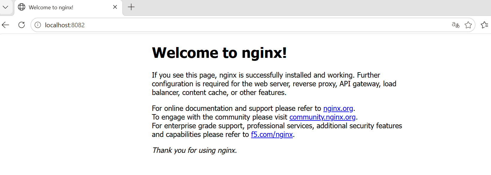

## 1단계 실행 환경
$ uname -a
MINGW64_NT-10.0-26300 GNIA-C402-D05 3.6.10-5a1665c8.x86_64 2026-09-28 10:40 UTC x86_64 Msys

$ echo $SHELL
/usr/bin/bash

$ git --version
git version 2.56.0.windows.4

$ docker --version
Docker version 29.9.3, build 5457199

$ docker info
 Client:
 Version:    29.9.3
 Context:    desktop-linux
 Debug Mode: false

Server:
 Containers: 0
  Running: 0
  Paused: 0
  Stopped: 0
 Images: 0
 Server Version: 29.9.3
 Storage Driver: overlayfs
 Cgroup Version: 2
 Kernel Version: 6.18.58.1-microsoft-standard-WSL2
 Operating System: Docker Desktop
 OSType: linux
 Architecture: x86_64
 CPUs: 24
 Total Memory: 15.25GiB
 Name: docker-desktop
 Debug Mode: false

## 2단계 터미널 기본조작 로그
$ pwd
/c/Users/wldn3089811/1-1/1-1

$ ls -a
./  ../  .git/  .gitignore  practice/  README.md

$ mkdir -p practice

$ cd practice

$ pwd
/c/Users/wldn3089811/1-1/1-1/practice

$ touch test.txt

$ ls
test.txt

$ echo "hello codyssey" > test.txt

$ cat test.txt
hello codyssey

$ cp test.txt copy.txt

$ ls
copy.txt  test.txt

$ mv copy.txt renamed.txt

$ ls
renamed.txt  test.txt

$ rm renamed.txt

$ ls
test.txt

$ cd ..

$ pwd
/c/Users/wldn3089811/1-1/1-1

## 3단계 권한 실습

$ ls -l README.md
-rw-r--r-- 1 wldn3089811 1049089 214 Nov 10 18:59 README.md

$ chmod 400 README.md
-r--r--r-- 1 wldn3089811 1049089 214 Nov 10 18:59 README.md

$ chmod 644 README.md

$ ls -l README.md
-rw-r--r-- 1 wldn3089811 1049089 214 Nov 10 18:59 README.md

$ ls -ld practice
drwxr-xr-x 1 wldn3089811 1049089 0 Nov 10 19:12 practice/

$ chmod 700 practice

$ ls -ld practice
drwxr-xr-x 1 wldn3089811 1049089 0 Nov 10 19:12 practice/

$ chmod 755 practice

$ ls -ld practice
drwxr-xr-x 1 wldn3089811 1049089 0 Nov 10 19:12 practice/

파일 권한은 `README.md`를 대상으로 실습했고, 디렉토리 권한은 `practice/`를 대상으로 실습했다.
`chmod`로 권한을 변경한 뒤 `ls -l`, `ls -ld`로 변경 전후를 비교했다.

## 4단계 Docker 기본 점검 및 운영 명령
$ docker --version
Docker version 29.9.3, build 5457199

$ docker info
 Client:
 Version:    29.9.3
 Context:    desktop-linux
 Debug Mode: false

Server:
 Containers: 0
  Running: 0
  Paused: 0
  Stopped: 0
 Images: 0
 Server Version: 29.9.3
 Storage Driver: overlayfs
 Cgroup Version: 2
 Kernel Version: 6.18.58.1-microsoft-standard-WSL2
 Operating System: Docker Desktop
 OSType: linux
 Architecture: x86_64
 CPUs: 24
 Total Memory: 15.25GiB
 Name: docker-desktop
 Debug Mode: false

$ docker images
                                   i Info →   U  In Use
IMAGE   ID             DISK USAGE   CONTENT SIZE

$ docker ps
CONTAINER ID   IMAGE     COMMAND   CREATED   STATUS    PORTS     NAMES

$ docker ps -a
CONTAINER ID   IMAGE     COMMAND   CREATED   STATUS    PORTS     NAMES

$ docker stats --no-stream
현재 실행 중인 컨테이너가 없어 `docker stats`에서 측정 대상이 없었다.

## 5단계 hello-world 컨테이너 실행
$ docker rm -f hello-test
hello-test

$ docker run --name hello-test hello-world

Hello from Docker!
This message shows that your installation appears to be working correctly.

$ docker ps -a
CONTAINER ID   IMAGE         COMMAND    CREATED          STATUS                      PORTS     NAMES
75973f50f156   hello-world   "/hello"   23 seconds ago   Exited (0) 23 seconds ago             hello-test

$ docker logs hello-test

Hello from Docker!
This message shows that your installation appears to be working correctly.

## 6단계 ubuntu 컨테이너 실행 및 내부 명령어 수행
$ docker rm -f ubuntu-practice

$ docker run -dit --name ubuntu-practice ubuntu bash
Unable to find image 'ubuntu:latest' locally
latest: Pulling from library/ubuntu
edafa32f5d9e: Pull complete 
f3f25b84a7d7: Pull complete 
21594acc2d8b: Download complete 
Digest: sha256:6a06111c3b0a8600feadb270aec771dc239bf407b25625f93f44ab00e11f4d3c
Status: Downloaded newer image for ubuntu:latest
4a1da9a2815a4397bf3f434320fd8fcef4c7cd379d5e71b7dc1c96025aaacdeb

$ docker ps
CONTAINER ID   IMAGE     COMMAND   CREATED          STATUS          PORTS     NAMES
4a1da9a2815a   ubuntu    "bash"    24 seconds ago   Up 23 seconds             ubuntu-practice

$ docker exec ubuntu-practice pwd
/

$ docker exec ubuntu-practice ls
bin
boot
dev
etc
home
lib
lib64
media
mnt
opt
proc
root
run
sbin
srv
sys
tmp
usr
var

$ docker exec ubuntu-practice bash -c "echo 'inside ubuntu container' > /tmp/test.txt"

$ docker exec ubuntu-practice cat /tmp/test.txt
cat: C:/Users/WLDN30~1/AppData/Local/Temp/test.txt: No such file or directory

$ docker logs ubuntu-practice

$ docker stop ubuntu-practice
ubuntu-practice

$ docker ps -a
CONTAINER ID   IMAGE         COMMAND    CREATED         STATUS                        PORTS     NAMES
4a1da9a2815a   ubuntu        "bash"     2 minutes ago   Exited (137) 10 seconds ago             ubuntu-practice
75973f50f156   hello-world   "/hello"   5 minutes ago   Exited (0) 5 minutes ago                hello-test

## 7단계 Dockerfile 기반 웹 서버 만들기
$ mkdir -p app

$ cat app/index.html
<!DOCTYPE html>
<html lang="ko">
<head>
  <meta charset="UTF-8">
  <title>Docker Web Server Test</title>
</head>
<body>
  <h1>Hello Docker Web Server!</h1>
  
This page is served by a custom NGINX Docker image.

</body>
</html>

$ cat Dockerfile
FROM nginx:alpine

COPY app/index.html /usr/share/nginx/html/index.html

EXPOSE 80

## 8단계 커스텀 이미지 빌드
$ docker build -t codyssey-nginx:1.0 .
[+] Building 1.2s (7/7) FINISHED   docker:desktop-linux
 => [internal] load build definition from Dockerf  0.0s
 => => transferring dockerfile: 123B               0.0s
 => [internal] load metadata for docker.io/librar  0.8s
 => [internal] load .dockerignore                  0.0s
 => => transferring context: 2B                    0.0s
 => [internal] load build context                  0.0s
 => => transferring context: 312B                  0.0s
 => CACHED [1/2] FROM docker.io/library/nginx:alp  0.0s
 => => resolve docker.io/library/nginx:alpine@sha  0.0s
 => [2/2] COPY app/index.html /usr/share/nginx/ht  0.0s
 => exporting to image                             0.2s
 => => exporting layers                            0.1s
 => => exporting manifest sha256:23803eb63f2a8e73  0.0s
 => => exporting config sha256:a91f637452a00b6fef  0.0s
 => => exporting attestation manifest sha256:846c  0.0s
 => => exporting manifest list sha256:48775ce28d7  0.0s
 => => naming to docker.io/library/codyssey-nginx  0.0s
 => => unpacking to docker.io/library/codyssey-ng  0.0s

 $ docker images                                                                                                                                                                                           
IMAGE                  ID             DISK USAGE   CONTENT SIZE   EXTRA
codyssey-nginx:1.0     48775ce28d7f       93.7MB         26.4MB        
hello-world:latest     c567b231f656       25.9kB         9.49kB    U   
my-web-server:latest   1fb7cdc0539f       93.7MB         26.4MB    U   
ubuntu:latest          6a06111c3b0a        163MB         45.9MB    U   

## 9단계 포트 매핑으로  웹 서버 실행
$ docker rm -f codyssey-web  

$ docker run -d --name codyssey-web -p 8081:80 codyssey-nginx:1.0
10803e3dbc23de6a893c34a90ea12062bbfa3f4647007bc5b67787331d21b8c0

$ docker ps
CONTAINER ID   IMAGE                COMMAND                   CREATED          STATUS          PORTS                                     NAMES
10803e3dbc23   codyssey-nginx:1.0   "/docker-entrypoint.…"   23 seconds ago   Up 22 seconds   0.0.0.0:8081->80/tcp, [::]:8081->80/tcp   codyssey-web
6d6f2988c55c   my-web-server        "/docker-entrypoint.…"   8 minutes ago    Up 8 minutes    0.0.0.0:8080->80/tcp, [::]:8080->80/tcp   web-test

$ curl http://localhost:8081
<!DOCTYPE html>
<html lang="ko">
<head>
  <meta charset="UTF-8">
  <title>Docker Web Server Test</title>
</head>
<body>
  <h1>Hello Docker Web Server!</h1>
  
This page is served by a custom NGINX Docker image.

</body>
</html>

### 브라우저 접속 증거

## 10단계 Docker 로그와 리소스 확인

$ docker logs codyssey-web
/docker-entrypoint.sh: Configuration complete; ready for start up
2026/11/10 11:08:48 [notice] 1#1: nginx/1.31.8
2026/11/10 11:08:48 [notice] 1#1: start worker processes
172.17.0.1 - - [10/Nov/2026:11:09:27 +0000] "GET / HTTP/1.1" 200 242 "-" "curl/8.23.0" "-"

$ docker stats --no-stream codyssey-web
CONTAINER ID   NAME           CPU %     MEM USAGE / LIMIT    MEM %     NET I/O          BLOCK I/O     PIDS
10803e3dbc23   codyssey-web   0.00%     20.9MiB / 15.25GiB   0.13%     4.2kB / 3.48kB   0B / 12.3kB   25

## 11단계 바인드 마운트 반영 검증
$ docker rm -f bind-web
bind-web

$ docker run -d --name bind-web -p 8082:80 -v "${PWD}/app:/usr/share/nginx/html:ro" nginx:alpine
326f1614a5927fed6f1c4dee237d0e975f69c58ae9adfe07cf4975853e71c3bb

$ curl http://localhost:8082
<!DOCTYPE html>
<html>
<head>
<title>Welcome to nginx!</title>

</head>
<body>
<h1>Welcome to nginx!</h1>

If you see this page, nginx is successfully installed and working.
Further configuration is required for the web server, reverse proxy, 
API gateway, load balancer, content cache, or other features.

$ cat app/index.html
<!DOCTYPE html>
<html lang="ko">
<head>
  <meta charset="UTF-8">
  <title>Docker Web Server Test</title>
</head>
<body>
  <h1>Hello Docker Web Server!</h1>
  
This page is served by a custom NGINX Docker image.

</body>
</html>

$ curl http://localhost:8082
<!DOCTYPE html>
<html>
<head>
<title>Welcome to nginx!</title>

</head>
<body>
<h1>Welcome to nginx!</h1>

If you see this page, nginx is successfully installed and working.
Further configuration is required for the web server, reverse proxy, 
API gateway, load balancer, content cache, or other features.

For online documentation and support please refer to
<a href="https://nginx.org/">nginx.org</a>. 
To engage with the community please visit
<a href="https://community.nginx.org/">community.nginx.org</a>. 
For enterprise grade support, professional services, additional 
security features and capabilities please refer to
<a href="https://f5.com/nginx">f5.com/nginx</a>.

<em>Thank you for using nginx.</em>

</body>
</html>

`app/index.html` 파일을 호스트에서 수정한 뒤 `curl http://localhost:8081` 결과가 변경되었다.
이를 통해 바인드 마운트가 정상적으로 반영됨을 확인했다.

## 12단계 Docker 볼륨 영속성 검증
$ docker volume create codyssey-volume
codyssey-volume

$ docker volume ls
DRIVER    VOLUME NAME
local     codyssey-volume

$ docker run -dit --name volume-test -v codyssey-volume:/data ubuntu bash
51bf2d48d5a05658eddbbe81fa9cfbcdd220b8eb1485262b9d60fe58ad76b4fb

$ docker exec volume-test bash -c "echo 'volume data is persistent' > /data/message.txt"

$ MSYS_NO_PATHCONV=1 docker exec volume-test cat /data/message.txt
volume data is persistent

$ docker rm -f volume-test
volume-test

$ MSYS_NO_PATHCONV=1 docker run --rm -v codyssey-volume:/data ubuntu cat /data/message.txt
volume data is persistent

$ docker volume inspect codyssey-volume
[
    {
        "CreatedAt": "2026-11-10T11:25:53Z",
        "Driver": "local",
        "Labels": null,
        "Mountpoint": "/var/lib/docker/volumes/codyssey-volume/_data",
        "Name": "codyssey-volume",
        "Options": null,
        "Scope": "local"
    }
]

첫 번째 컨테이너에서 `/data/message.txt` 파일을 생성한 뒤 컨테이너를 삭제했다.
이후 같은 볼륨을 새 컨테이너에 연결하여 파일 내용을 다시 확인했다.
컨테이너 삭제 후에도 데이터가 유지되므로 Docker 볼륨의 영속성을 확인했다.

## 13단계 컨테이너 중지/정리 확인
$ docker ps
CONTAINER ID   IMAGE                COMMAND                   CREATED          STATUS          PORTS                                     NAMES
326f1614a592   nginx:alpine         "/docker-entrypoint.…"   11 minutes ago   Up 11 minutes   0.0.0.0:8082->80/tcp, [::]:8082->80/tcp   bind-web
10803e3dbc23   codyssey-nginx:1.0   "/docker-entrypoint.…"   22 minutes ago   Up 22 minutes   0.0.0.0:8081->80/tcp, [::]:8081->80/tcp   codyssey-web
6d6f2988c55c   my-web-server        "/docker-entrypoint.…"   30 minutes ago   Up 30 minutes   0.0.0.0:8080->80/tcp, [::]:8080->80/tcp   web-test

$ docker stop codyssey-web
codyssey-web

$ docker ps -a
CONTAINER ID   IMAGE                COMMAND                   CREATED          STATUS                        PORTS                                     NAMES
326f1614a592   nginx:alpine         "/docker-entrypoint.…"   11 minutes ago   Up 11 minutes                 0.0.0.0:8082->80/tcp, [::]:8082->80/tcp   bind-web
10803e3dbc23   codyssey-nginx:1.0   "/docker-entrypoint.…"   22 minutes ago   Exited (0) 8 seconds ago                                                codyssey-web
6d6f2988c55c   my-web-server        "/docker-entrypoint.…"   31 minutes ago   Up 31 minutes                 0.0.0.0:8080->80/tcp, [::]:8080->80/tcp   web-test
4a1da9a2815a   ubuntu               "bash"                    40 minutes ago   Exited (137) 38 minutes ago                                             ubuntu-practice
75973f50f156   hello-world          "/hello"                  43 minutes ago   Exited (0) 43 minutes ago                                               hello-test

## 14단계 Git 설정 확인
$ git config --global user.name
w*d*3*8

$ git config --global user.email
w*d*3*8@naver.com

$ git config --global init.defaultBranch main

$ git config --list
diff.astextplain.textconv=astextplain
filter.lfs.clean=git-lfs clean -- %f
filter.lfs.smudge=git-lfs smudge -- %f
filter.lfs.process=git-lfs filter-process
filter.lfs.required=true
http.sslbackend=schannel
core.autocrlf=true
core.fscache=true
core.symlinks=false
pull.rebase=false
credential.helper=manager
credential.https://dev.azure.com.usehttppath=true
init.defaultbranch=master
user.name=w*d*3*8
user.email=w*d*3*8@naver.com
init.defaultbranch=main
core.repositoryformatversion=0
core.filemode=false
core.bare=false
core.logallrefupdates=true
core.symlinks=false
core.ignorecase=true
remote.origin.url=https://github.com/wldn308/1-1.git
remote.origin.fetch=+refs/heads/*:refs/remotes/origin/*
branch.main.remote=origin
branch.main.merge=refs/heads/main
branch.main.vscode-merge-base=origin/main

$ git remote -v
origin  https://github.com/wldn308/1-1.git (fetch)
origin  https://github.com/wldn308/1-1.git (push)

$ git status
On branch main
Your branch is up to date with 'origin/main'.

Changes not staged for commit:
  (use "git add <file>..." to update what will be committed)
  (use "git restore <file>..." to discard changes in working directory)
        modified:   README.md
        modified:   practice/test.txt

Untracked files:
  (use "git add <file>..." to include in what will be committed)
        Dockerfile
        app/
        docs/

no changes added to commit (use "git add" and/or "git commit -a")

## 15단계 VSCode / GitHub 연동 증거

| VSCode Source Control | GitHub 저장소 |
|---|---|
|  |  |

## 16단계 GitHub 업로드
$ git status
On branch main
Your branch is up to date with 'origin/main'.

Changes not staged for commit:
  (use "git add <file>..." to update what will be committed)
  (use "git restore <file>..." to discard changes in working directory)
        modified:   README.md
        modified:   practice/test.txt

Untracked files:
  (use "git add <file>..." to include in what will be committed)
        Dockerfile
        app/
        docs/

no changes added to commit (use "git add" and/or "git commit -a")

$ git add .
warning: in the working copy of 'practice/test.txt', LF will be replaced by CRLF the next time Git touches it

$ git commit -m "최종 README 및 증빙 이미지 추가"
[main 90e968c] 최종 README 및 증빙 이미지 추가
 8 files changed, 511 insertions(+), 85 deletions(-)
 create mode 100644 Dockerfile
 create mode 100644 app/index.html
 create mode 100644 docs/images/bind-mount-8082.png
 create mode 100644 docs/images/port-8081-browser.png
 create mode 100644 docs/images/vs-git1.png
 create mode 100644 docs/images/vs-git2.png
 create mode 100644 docs/images/vs-git3.png

 $ git push origin main
Enumerating objects: 15, done.
Counting objects: 100% (15/15), done.
Delta compression using up to 24 threads
Compressing objects: 100% (11/11), done.
Writing objects: 100% (13/13), 715.37 KiB | 35.77 MiB/s, done.
Total 13 (delta 0), reused 0 (delta 0), pack-reused 0 (from 0)
To https://github.com/wldn308/1-1.git
   b86c5af..90e968c  main -> main
   