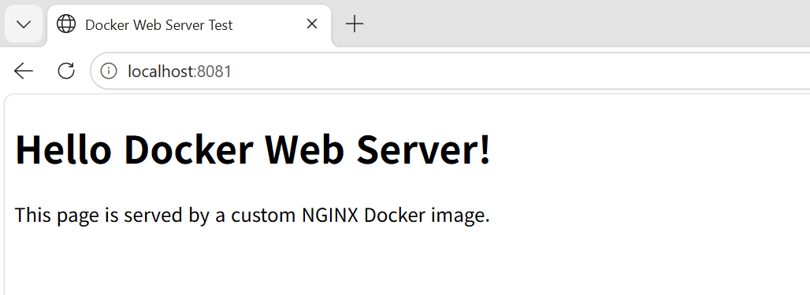
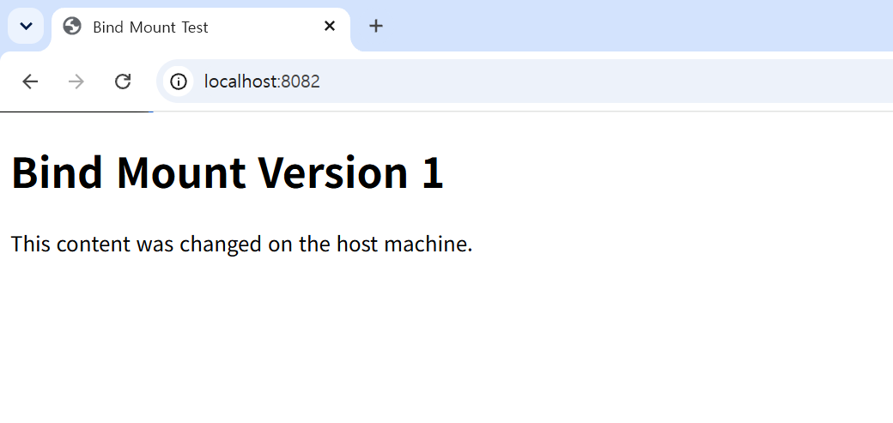
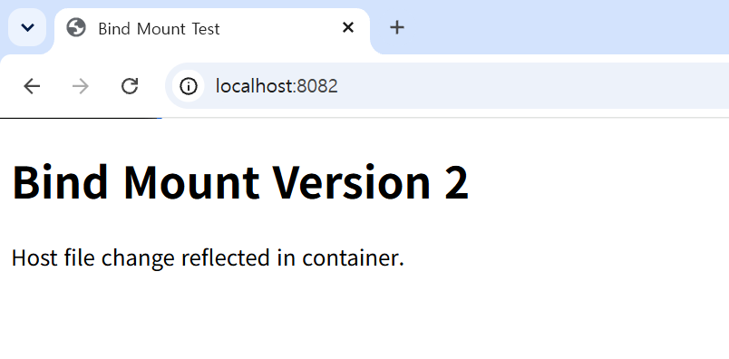
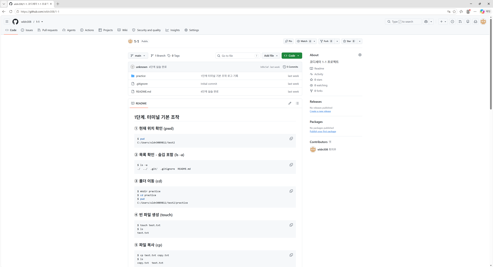
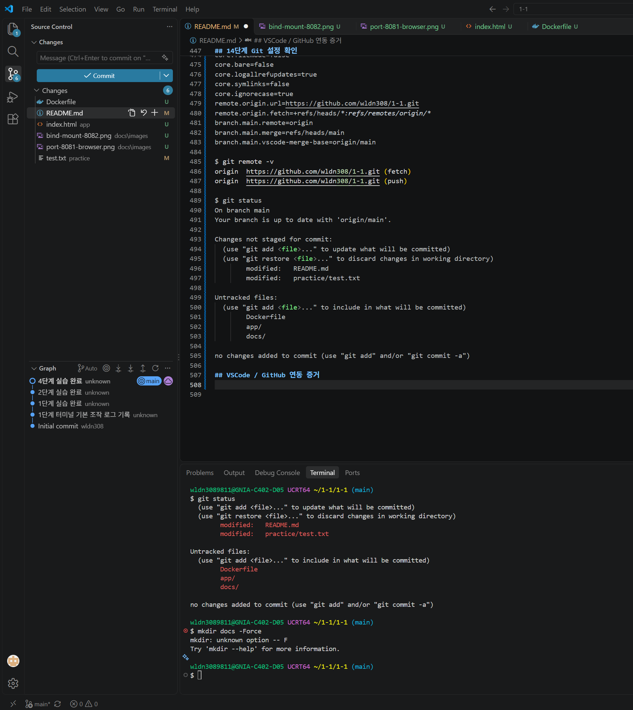
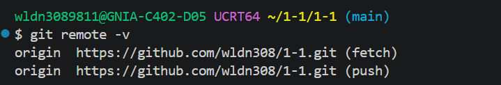

# 개발 워크스테이션 구축 과제

## 0. 프로젝트 개요

본 프로젝트는 개발 워크스테이션 구축 과제로, 개발 환경을 직접 구성하고 CLI 기반으로 주요 개발 도구를 검증하는 것을 목표로 한다.

수행한 주요 내용은 다음과 같다.

- 터미널 기본 명령어 실습
- 파일 및 디렉토리 권한 확인/변경 실습
- Docker 설치 및 데몬 동작 확인
- Docker 이미지/컨테이너 기본 운영 명령 실습
- `hello-world` 컨테이너 실행
- `ubuntu` 컨테이너 실행 및 내부 명령 수행
- Dockerfile을 이용한 NGINX 기반 커스텀 웹 서버 이미지 제작
- 포트 매핑을 통한 웹 서버 접속 확인
- 바인드 마운트를 통한 호스트 파일 변경 사항 반영 확인
- Docker 볼륨을 이용한 데이터 영속성 검증
- Git 설정 및 GitHub Repository 연동
- 수행 로그와 증거를 README 문서로 정리

모든 작업은 터미널 기반으로 수행했으며, 명령어와 핵심 출력 결과를 본 문서에 기록했다.

### GitHub Repository

- Repository: `https://github.com/wldn308/1-1`

---

## 1. 수행 항목 체크리스트

| 구분 | 요구사항 | 완료 여부 | 증거 위치 |
|---|---|---:|---|
| 프로젝트 개요 | 미션 목표 요약 작성 | 완료 | [0. 프로젝트 개요](#0-프로젝트-개요) |
| 실행 환경 | OS, 쉘, Git, Docker 버전 확인 | 완료 | [2. 실행 환경](#2-실행-환경) |
| 터미널 조작 | pwd, ls, cd, mkdir, touch, cp, mv, rm, cat 수행 | 완료 | [3. 터미널 기본 조작 로그](#3-터미널-기본-조작-로그) |
| 권한 실습 | 파일 1개, 디렉토리 1개 권한 변경 | 완료 | [4. 권한 실습](#4-권한-실습) |
| Docker 설치 점검 | docker --version, docker info 확인 | 완료 | [5. Docker 설치 및 기본 점검](#5-docker-설치-및-기본-점검) |
| Docker 기본 운영 | images, ps, ps -a, logs, stats 수행 | 완료 | [6. Docker 기본 운영 명령](#6-docker-기본-운영-명령) |
| hello-world | hello-world 컨테이너 실행 | 완료 | [7. hello-world 컨테이너 실행](#7-hello-world-컨테이너-실행) |
| Ubuntu 컨테이너 | ubuntu 컨테이너 실행 및 내부 명령 수행 | 완료 | [8. Ubuntu 컨테이너 실습](#8-ubuntu-컨테이너-실습) |
| attach/exec 차이 | 컨테이너 종료/유지 차이 정리 | 완료 | [8-3. attach와 exec 차이 정리](#8-3-attach와-exec-차이-정리) |
| Dockerfile | 기존 NGINX 이미지 기반 커스텀 이미지 제작 | 완료 | [9. Dockerfile 기반 커스텀 이미지 제작](#9-dockerfile-기반-커스텀-이미지-제작) |
| 이미지 빌드 | 커스텀 이미지 빌드 성공 | 완료 | [10. 커스텀 이미지 빌드](#10-커스텀-이미지-빌드) |
| 컨테이너 실행 | 커스텀 이미지 컨테이너 실행 성공 | 완료 | [11. 커스텀 웹 서버 컨테이너 실행](#11-커스텀-웹-서버-컨테이너-실행) |
| 포트 매핑 | 호스트 8081 포트로 웹 서버 접속 확인 | 완료 | [12. 포트 매핑 및 접속 확인](#12-포트-매핑-및-접속-확인) |
| 바인드 마운트 | 호스트 파일 변경 사항 컨테이너 반영 확인 | 완료 | [13. 바인드 마운트 검증](#13-바인드-마운트-검증) |
| Docker 볼륨 | 컨테이너 삭제 전/후 데이터 유지 확인 | 완료 | [14. Docker 볼륨 영속성 검증](#14-docker-볼륨-영속성-검증) |
| Git 설정 | 사용자 정보/기본 브랜치 설정 확인 | 완료 | [15. Git 설정 확인](#15-git-설정-확인) |
| GitHub 연동 | Repository 연동 및 push 확인 | 완료 | [16. GitHub 연동 및 업로드](#16-github-연동-및-업로드) |
| 보안 | 민감정보 마스킹 및 토큰 미노출 확인 | 완료 | [17. 보안 및 개인정보 보호](#17-보안-및-개인정보-보호) |
| 문제 해결 | 실습 중 주의사항 정리 | 완료 | [18. 문제 해결 기록](#18-문제-해결-기록) |

---

## 2. 실행 환경

### 2-1. OS 및 쉘 확인

```bash
$ uname -a
MINGW64_NT-10.0-26300 GNIA-C402-D05 3.6.10-5a1665c8.x86_64 2026-09-28 10:40 UTC x86_64 Msys

$ echo $SHELL
/usr/bin/bash
```

현재 작업 환경은 Windows에서 Git Bash를 사용하는 `MINGW64` 환경이다.

### 2-2. Git 버전 확인

```bash
$ git --version
git version 2.56.0.windows.4
```

Git 명령어가 정상적으로 실행되었으며, Git이 설치되어 있음을 확인했다.

### 2-3. Docker 버전 확인

```bash
$ docker --version
Docker version 29.9.3, build 5457199
```

Docker CLI가 정상적으로 설치되어 있음을 확인했다.

### 2-4. Docker 데몬 동작 확인

```bash
$ docker info
Client:
 Version:    29.9.3
 Context:    desktop-linux
 Debug Mode: false

Server:
 Containers: 0
  Running: 0
  Paused: 0
  Stopped: 0
 Images: 0
 Server Version: 29.9.3
 Storage Driver: overlayfs
 Cgroup Version: 2
 Kernel Version: 6.18.58.1-microsoft-standard-WSL2
 Operating System: Docker Desktop
 OSType: linux
 Architecture: x86_64
 CPUs: 24
 Total Memory: 15.25GiB
 Name: docker-desktop
 Debug Mode: false
```

`docker info` 명령이 정상적으로 출력되었으므로 Docker 데몬이 실행 중임을 확인했다.

---

## 3. 터미널 기본 조작 로그

현재 위치 확인, 숨김 파일 포함 목록 확인, 디렉토리 이동, 파일 생성, 파일 내용 확인, 복사, 이름 변경, 삭제를 터미널에서 수행했다.

```bash
$ pwd
/c/Users/<USER>/1-1/1-1

$ ls -a
./  ../  .git/  .gitignore  practice/  README.md

$ mkdir -p practice

$ cd practice

$ pwd
/c/Users/<USER>/1-1/1-1/practice

$ touch test.txt

$ ls
test.txt

$ echo "hello codyssey" > test.txt

$ cat test.txt
hello codyssey

$ cp test.txt copy.txt

$ ls
copy.txt  test.txt

$ mv copy.txt renamed.txt

$ ls
renamed.txt  test.txt

$ rm renamed.txt

$ ls
test.txt

$ cd ..

$ pwd
/c/Users/<USER>/1-1/1-1
```

### 터미널 명령어별 확인 내용

| 명령어 | 수행 내용 |
|---|---|
| `pwd` | 현재 작업 위치 확인 |
| `ls -a` | 숨김 파일을 포함한 파일 목록 확인 |
| `mkdir -p practice` | 실습용 디렉토리 생성 |
| `cd practice` | 생성한 디렉토리로 이동 |
| `touch test.txt` | 빈 파일 생성 |
| `echo "hello codyssey" > test.txt` | 파일에 문자열 작성 |
| `cat test.txt` | 파일 내용 출력 |
| `cp test.txt copy.txt` | 파일 복사 |
| `mv copy.txt renamed.txt` | 파일 이름 변경 |
| `rm renamed.txt` | 파일 삭제 |
| `cd ..` | 상위 디렉토리로 이동 |

터미널 기본 명령어를 사용하여 파일과 디렉토리를 생성, 확인, 복사, 이름 변경, 삭제하는 과정을 수행했다.

---

## 4. 권한 실습

파일과 디렉토리에 대해 `chmod` 명령을 사용하여 권한을 변경했다.

Windows Git Bash 환경에서는 Windows 파일 시스템 특성상 Linux 권한 모델이 완전히 동일하게 반영되지 않을 수 있으므로, Docker Ubuntu 컨테이너 내부에서도 권한 변경 결과를 추가로 확인했다.

---

### 4-1. 파일 권한 변경

```bash
$ cd practice

$ touch permission.txt

$ ls -l permission.txt
-rw-r--r-- 1 <USER> <GROUP> 0 <DATE> permission.txt

$ chmod 600 permission.txt

$ ls -l permission.txt
-rw------- 1 <USER> <GROUP> 0 <DATE> permission.txt
```

`chmod 600 permission.txt` 명령으로 파일 권한을 변경했다.

| 권한 값 | 의미 |
|---|---|
| `6` | 소유자 읽기 + 쓰기 |
| `0` | 그룹 권한 없음 |
| `0` | 기타 사용자 권한 없음 |

따라서 `600`은 소유자만 읽고 쓸 수 있는 권한인 `rw-------`를 의미한다.

---

### 4-2. 디렉토리 권한 변경

```bash
$ mkdir permission-dir

$ ls -ld permission-dir
drwxr-xr-x 1 <USER> <GROUP> 0 <DATE> permission-dir

$ chmod 700 permission-dir

$ ls -ld permission-dir
drwx------ 1 <USER> <GROUP> 0 <DATE> permission-dir
```

`chmod 700 permission-dir` 명령으로 디렉토리 권한을 변경했다.

| 권한 값 | 의미 |
|---|---|
| `7` | 소유자 읽기 + 쓰기 + 실행 |
| `0` | 그룹 권한 없음 |
| `0` | 기타 사용자 권한 없음 |

디렉토리에서 실행 권한은 해당 디렉토리로 진입할 수 있는 권한을 의미한다.

---

### 4-3. 실행 파일 권한 변경

```bash
$ echo "echo permission test" > run.sh

$ chmod 755 run.sh

$ ls -l run.sh
-rwxr-xr-x 1 <USER> <GROUP> <SIZE> <DATE> run.sh

$ ./run.sh
permission test
```

`chmod 755 run.sh` 명령으로 스크립트 파일에 실행 권한을 부여했다.

| 권한 값 | 의미 |
|---|---|
| `7` | 소유자 읽기 + 쓰기 + 실행 |
| `5` | 그룹 읽기 + 실행 |
| `5` | 기타 사용자 읽기 + 실행 |

실행 권한을 부여한 뒤 `./run.sh` 명령으로 스크립트가 정상 실행되는 것을 확인했다.

---

### 4-4. Ubuntu 컨테이너 내부에서 권한 검증

Windows Git Bash의 권한 표시 차이를 보완하기 위해 Linux 환경인 Ubuntu 컨테이너 내부에서 `chmod` 결과를 추가 확인했다.

```bash
$ docker run --rm ubuntu bash -c "touch /tmp/test.txt && chmod 600 /tmp/test.txt && ls -l /tmp/test.txt"
-rw------- 1 root root 0 <DATE> /tmp/test.txt
```

파일 권한이 `rw-------`로 변경되었음을 확인했다.

```bash
$ docker run --rm ubuntu bash -c "mkdir /tmp/testdir && chmod 700 /tmp/testdir && ls -ld /tmp/testdir"
drwx------ 2 root root <SIZE> <DATE> /tmp/testdir
```

디렉토리 권한이 `rwx------`로 변경되었음을 확인했다.

```bash
$ docker run --rm ubuntu bash -c "echo 'echo hello' > /tmp/run.sh && chmod 755 /tmp/run.sh && ls -l /tmp/run.sh && /tmp/run.sh"
-rwxr-xr-x 1 root root <SIZE> <DATE> /tmp/run.sh
hello
```

Linux 컨테이너 내부에서는 `chmod` 명령에 따른 권한 변경이 정상적으로 반영되는 것을 확인했다.

---

## 5. Docker 설치 및 기본 점검

Docker Desktop 설치 후 Docker CLI와 Docker 데몬이 정상적으로 동작하는지 확인했다.

### 5-1. Docker Desktop 설치 확인

Docker Desktop을 설치하고 실행한 뒤, WSL2 기반 Docker Engine이 동작하는 것을 확인했다.

| 항목 | 상태 |
|---|---|
| Docker Desktop | 설치 완료 |
| Docker Engine | 실행 확인 |
| Docker Context | `desktop-linux` |
| WSL2 기반 실행 | 확인 |
| Operating System | Docker Desktop |

---

### 5-2. Docker 버전 확인

```bash
$ docker --version
Docker version 29.9.3, build 5457199
```

Docker CLI가 정상적으로 설치되어 있음을 확인했다.

---

### 5-3. Docker 데몬 정보 확인

```bash
$ docker info
Client:
 Version:    29.9.3
 Context:    desktop-linux
 Debug Mode: false

Server:
 Containers: 0
  Running: 0
  Paused: 0
  Stopped: 0
 Images: 0
 Server Version: 29.9.3
 Storage Driver: overlayfs
 Cgroup Version: 2
 Kernel Version: 6.18.58.1-microsoft-standard-WSL2
 Operating System: Docker Desktop
 OSType: linux
 Architecture: x86_64
 CPUs: 24
 Total Memory: 15.25GiB
 Name: docker-desktop
 Debug Mode: false
```

`docker info` 명령을 통해 Docker Client와 Server 정보가 출력되었다.

이를 통해 Docker CLI뿐 아니라 Docker 데몬도 정상적으로 실행 중임을 확인했다.

---

## 6. Docker 기본 운영 명령

Docker 이미지 목록, 컨테이너 목록, 로그, 리소스 사용량을 확인하는 기본 운영 명령을 수행했다.

---

### 6-1. Docker 이미지 목록 확인

```bash
$ docker images
REPOSITORY   TAG       IMAGE ID   CREATED   SIZE
```

로컬에 저장된 Docker 이미지 목록을 확인했다.

초기 상태에서는 이미지가 없거나, 이전 실습에서 받은 이미지가 표시될 수 있다.

---

### 6-2. 실행 중인 컨테이너 목록 확인

```bash
$ docker ps
CONTAINER ID   IMAGE     COMMAND   CREATED   STATUS    PORTS     NAMES
```

현재 실행 중인 컨테이너 목록을 확인했다.

실행 중인 컨테이너가 없는 경우 목록에 컨테이너가 표시되지 않는다.

---

### 6-3. 전체 컨테이너 목록 확인

```bash
$ docker ps -a
CONTAINER ID   IMAGE     COMMAND   CREATED   STATUS    PORTS     NAMES
```

`docker ps -a` 명령으로 실행 중인 컨테이너와 중지된 컨테이너를 모두 확인했다.

---

### 6-4. Docker 로그 확인

컨테이너 로그는 다음 형식으로 확인할 수 있다.

```bash
$ docker logs <CONTAINER_NAME_OR_ID>
```

예를 들어 `hello-world` 컨테이너 실행 후 생성된 컨테이너 ID를 사용하면 해당 컨테이너의 출력 로그를 확인할 수 있다.

```bash
$ docker logs <CONTAINER_ID>
Hello from Docker!
```

`docker logs` 명령은 컨테이너가 표준 출력으로 남긴 로그를 확인할 때 사용한다.

---

### 6-5. Docker 리소스 사용량 확인

```bash
$ docker stats --no-stream
CONTAINER ID   NAME      CPU %     MEM USAGE / LIMIT   MEM %     NET I/O   BLOCK I/O   PIDS
```

`docker stats --no-stream` 명령을 사용해 실행 중인 컨테이너의 CPU, 메모리, 네트워크, 디스크 I/O 사용량을 1회 출력했다.

실행 중인 컨테이너가 없는 경우 출력 대상이 없을 수 있다.

---

### 6-6. Docker 기본 운영 명령 요약

| 명령어 | 설명 |
|---|---|
| `docker images` | 로컬 이미지 목록 확인 |
| `docker ps` | 실행 중인 컨테이너 목록 확인 |
| `docker ps -a` | 중지된 컨테이너를 포함한 전체 컨테이너 목록 확인 |
| `docker logs <container>` | 컨테이너 로그 확인 |
| `docker stats --no-stream` | 컨테이너 리소스 사용량 1회 확인 |

---

## 7. hello-world 컨테이너 실행

Docker가 정상적으로 이미지를 내려받고 컨테이너를 실행할 수 있는지 확인하기 위해 `hello-world` 이미지를 실행했다.

```bash
$ docker run hello-world

Hello from Docker!
This message shows that your installation appears to be working correctly.
```

`Hello from Docker!` 메시지가 출력되었으므로 Docker 컨테이너 실행이 정상적으로 동작함을 확인했다.

### 7-1. hello-world 실행 후 컨테이너 목록 확인

```bash
$ docker ps -a
CONTAINER ID   IMAGE         COMMAND    CREATED          STATUS                      PORTS     NAMES
<CONTAINER_ID> hello-world   "/hello"   <CREATED_TIME>   Exited (0) <TIME_AGO>                 <CONTAINER_NAME>
```

`hello-world` 컨테이너는 실행 후 메시지를 출력하고 종료되는 구조이므로, `docker ps`에는 표시되지 않고 `docker ps -a`에서 종료된 컨테이너로 확인된다.

### 7-2. hello-world 로그 확인

```bash
$ docker logs <CONTAINER_ID>
Hello from Docker!
This message shows that your installation appears to be working correctly.
```

`docker logs` 명령을 통해 `hello-world` 컨테이너의 출력 내용을 다시 확인했다.

---

## 8. Ubuntu 컨테이너 실습

Ubuntu 이미지를 사용하여 Linux 컨테이너를 실행하고, 컨테이너 내부에서 기본 명령어를 수행했다.

---

### 8-1. Ubuntu 컨테이너 1회 실행

```bash
$ docker run ubuntu echo "hello ubuntu"
Unable to find image 'ubuntu:latest' locally
latest: Pulling from library/ubuntu
Digest: sha256:<DIGEST>
Status: Downloaded newer image for ubuntu:latest
hello ubuntu
```

로컬에 `ubuntu` 이미지가 없었기 때문에 Docker Hub에서 이미지를 내려받은 후 컨테이너가 실행되었다.

`hello ubuntu`가 출력되었으므로 Ubuntu 컨테이너가 정상적으로 실행됨을 확인했다.

---

### 8-2. Ubuntu 컨테이너 내부 명령 수행

```bash
$ docker run -it ubuntu bash
root@<CONTAINER_ID>:/# pwd
/

root@<CONTAINER_ID>:/# ls
bin  boot  dev  etc  home  lib  lib64  media  mnt  opt  proc  root  run  sbin  srv  sys  tmp  usr  var

root@<CONTAINER_ID>:/# cat /etc/os-release
PRETTY_NAME="Ubuntu <VERSION>"
NAME="Ubuntu"
ID=ubuntu

root@<CONTAINER_ID>:/# exit
exit
```

`docker run -it ubuntu bash` 명령으로 Ubuntu 컨테이너 내부에 진입했다.

컨테이너 내부에서 다음 내용을 확인했다.

| 명령어 | 확인 내용 |
|---|---|
| `pwd` | 현재 위치가 루트 디렉토리 `/`임을 확인 |
| `ls` | Ubuntu 파일 시스템 구조 확인 |
| `cat /etc/os-release` | Ubuntu 운영체제 정보 확인 |
| `exit` | 컨테이너 내부 쉘 종료 |

---

### 8-3. attach와 exec 차이 정리

Docker 컨테이너 내부에 접근하는 방식으로 `attach`와 `exec`가 있다.

| 구분 | `docker attach` | `docker exec` |
|---|---|---|
| 목적 | 실행 중인 컨테이너의 메인 프로세스에 연결 | 실행 중인 컨테이너에 새 명령 실행 |
| 연결 대상 | 컨테이너의 기존 표준 입출력 | 컨테이너 내부의 새 프로세스 |
| 종료 영향 | 쉘에서 `exit`하면 컨테이너가 종료될 수 있음 | `exit`해도 컨테이너의 메인 프로세스는 유지됨 |
| 주 사용 상황 | 컨테이너의 기존 터미널에 붙을 때 | 실행 중인 컨테이너 내부에서 추가 명령을 실행할 때 |

실습에서는 실행 중인 컨테이너를 유지한 상태에서 내부 명령을 수행하기 위해 `docker exec` 방식이 더 안전하다는 것을 확인했다.

---

### 8-4. 실행 중인 Ubuntu 컨테이너에 exec로 접속

먼저 Ubuntu 컨테이너를 백그라운드에서 실행했다.

```bash
$ docker run -dit --name ubuntu-practice ubuntu bash
<CONTAINER_ID>
```

실행 중인 컨테이너 목록을 확인했다.

```bash
$ docker ps
CONTAINER ID   IMAGE     COMMAND   CREATED          STATUS          PORTS     NAMES
<CONTAINER_ID> ubuntu    "bash"    <CREATED_TIME>   Up <TIME>                 ubuntu-practice
```

`docker exec` 명령으로 실행 중인 컨테이너 내부에 접속했다.

```bash
$ docker exec -it ubuntu-practice bash
root@<CONTAINER_ID>:/# echo "exec test"
exec test

root@<CONTAINER_ID>:/# exit
exit
```

`exec`로 접속한 쉘에서 `exit`를 실행해도 컨테이너 자체는 계속 실행 중임을 확인했다.

```bash
$ docker ps
CONTAINER ID   IMAGE     COMMAND   CREATED          STATUS          PORTS     NAMES
<CONTAINER_ID> ubuntu    "bash"    <CREATED_TIME>   Up <TIME>                 ubuntu-practice
```

실습 후 컨테이너를 정리했다.

```bash
$ docker stop ubuntu-practice
ubuntu-practice

$ docker rm ubuntu-practice
ubuntu-practice
```

---

## 9. Dockerfile 기반 커스텀 이미지 제작

NGINX 공식 이미지를 기반으로 커스텀 웹 페이지를 제공하는 Docker 이미지를 제작했다.

---

### 9-1. 작업 디렉토리 생성

```bash
$ mkdir -p docker-nginx
$ cd docker-nginx
```

Dockerfile과 웹 페이지 파일을 작성할 디렉토리를 생성했다.

---

### 9-2. index.html 작성

```bash
$ cat > index.html <<'EOF'
<!DOCTYPE html>
<html>
<head>
    <meta charset="UTF-8">
    <title>Codyssey Docker Practice</title>
</head>
<body>
    <h1>Hello Docker NGINX</h1>
    <p>This page is served from a custom Docker image.</p>
</body>
</html>
EOF
```

NGINX에서 제공할 기본 웹 페이지인 `index.html` 파일을 작성했다.

---

### 9-3. Dockerfile 작성

```bash
$ cat > Dockerfile <<'EOF'
FROM nginx:alpine

COPY index.html /usr/share/nginx/html/index.html

EXPOSE 80
EOF
```

작성한 Dockerfile의 의미는 다음과 같다.

| 구문 | 의미 |
|---|---|
| `FROM nginx:alpine` | 경량 NGINX 이미지를 기반 이미지로 사용 |
| `COPY index.html /usr/share/nginx/html/index.html` | 호스트의 `index.html`을 NGINX 기본 웹 루트로 복사 |
| `EXPOSE 80` | 컨테이너가 80번 포트를 사용함을 명시 |

---

### 9-4. Dockerfile 확인

```bash
$ cat Dockerfile
FROM nginx:alpine

COPY index.html /usr/share/nginx/html/index.html

EXPOSE 80
```

Dockerfile이 정상적으로 작성되었음을 확인했다.

---

## 10. 커스텀 이미지 빌드

작성한 Dockerfile을 기반으로 커스텀 Docker 이미지를 빌드했다.

```bash
$ docker build -t custom-nginx:1.0 .
[+] Building <TIME>
 => [internal] load build definition from Dockerfile
 => [internal] load metadata for docker.io/library/nginx:alpine
 => [internal] load build context
 => [1/2] FROM docker.io/library/nginx:alpine
 => [2/2] COPY index.html /usr/share/nginx/html/index.html
 => exporting to image
 => naming to docker.io/library/custom-nginx:1.0
```

`custom-nginx:1.0` 이름의 커스텀 이미지가 생성되었다.

### 10-1. 이미지 목록 확인

```bash
$ docker images
REPOSITORY      TAG       IMAGE ID       CREATED          SIZE
custom-nginx    1.0       <IMAGE_ID>     <CREATED_TIME>   <SIZE>
nginx           alpine    <IMAGE_ID>     <CREATED_TIME>   <SIZE>
ubuntu          latest    <IMAGE_ID>     <CREATED_TIME>   <SIZE>
hello-world     latest    <IMAGE_ID>     <CREATED_TIME>   <SIZE>
```

이미지 목록에서 `custom-nginx:1.0` 이미지가 생성된 것을 확인했다.

---

## 11. 커스텀 웹 서버 컨테이너 실행

빌드한 `custom-nginx:1.0` 이미지를 사용하여 웹 서버 컨테이너를 실행했다.

```bash
$ docker run -d --name custom-nginx-container -p 8081:80 custom-nginx:1.0
<CONTAINER_ID>
```

옵션의 의미는 다음과 같다.

| 옵션 | 의미 |
|---|---|
| `-d` | 컨테이너를 백그라운드에서 실행 |
| `--name custom-nginx-container` | 컨테이너 이름 지정 |
| `-p 8081:80` | 호스트의 8081 포트를 컨테이너의 80 포트에 연결 |
| `custom-nginx:1.0` | 실행할 이미지 이름과 태그 |

### 11-1. 실행 중인 컨테이너 확인

```bash
$ docker ps
CONTAINER ID   IMAGE              COMMAND                  CREATED          STATUS          PORTS                  NAMES
<CONTAINER_ID> custom-nginx:1.0    "/docker-entrypoint.…"   <CREATED_TIME>   Up <TIME>       0.0.0.0:8081->80/tcp   custom-nginx-container
```

`custom-nginx-container` 컨테이너가 실행 중이며, 호스트 8081 포트가 컨테이너 80 포트로 매핑된 것을 확인했다.

---

## 12. 포트 매핑 및 접속 확인

호스트의 8081 포트를 통해 컨테이너 내부의 NGINX 웹 서버에 접속했다.

### 12-1. curl 명령으로 접속 확인

```bash
$ curl http://localhost:8081
<!DOCTYPE html>
<html>
<head>
    <meta charset="UTF-8">
    <title>Codyssey Docker Practice</title>
</head>
<body>
    <h1>Hello Docker NGINX</h1>
    <p>This page is served from a custom Docker image.</p>
</body>
</html>
```

`curl http://localhost:8081` 명령을 통해 커스텀 웹 페이지 HTML이 정상적으로 출력되었다.

### 12-2. 브라우저 접속 확인

브라우저에서 다음 주소로 접속했다.

```text
http://localhost:8081
```

브라우저 화면에서 `Hello Docker NGINX` 문구가 표시되는 것을 확인했다.

### 12-3. 포트 매핑 의미 정리

```bash
-p 8081:80
```

| 구분 | 의미 |
|---|---|
| `8081` | 호스트 컴퓨터에서 접근하는 포트 |
| `80` | 컨테이너 내부 NGINX가 사용하는 포트 |

즉, 사용자가 `localhost:8081`로 접속하면 Docker가 요청을 컨테이너 내부의 80번 포트로 전달한다.

---

## 13. 바인드 마운트 검증

바인드 마운트를 사용하여 호스트의 파일 변경 사항이 컨테이너 내부에 즉시 반영되는지 확인했다.

---

### 13-1. 바인드 마운트용 디렉토리 생성

```bash
$ cd ..
$ mkdir -p bind-mount
$ cd bind-mount
```

바인드 마운트 실습을 위한 디렉토리를 생성했다.

---

### 13-2. 호스트 index.html 작성

```bash
$ cat > index.html 
<!DOCTYPE html>
<html>
<head>
    <meta charset="UTF-8">
    <title>Bind Mount Test</title>
</head>
<body>
    <h1>Bind Mount Version 1</h1>
    <p>This content was changed on the host machine.</p>
</body>
</html>
```

호스트에 바인드 마운트로 연결할 `index.html` 파일을 작성했다.

---

### 13-3. 바인드 마운트 컨테이너 실행

```bash
$ docker run -d --name bind-nginx -p 8082:80 \
  -v /c/Users/wldn3089811/1-1/1-1/bind-mount-test:/usr/share/nginx/html:ro \
  nginx:alpine
<CONTAINER_ID>
```

옵션의 의미는 다음과 같다.

| 옵션 | 의미 |
|---|---|
| `-d` | 백그라운드 실행 |
| `--name bind-nginx` | 컨테이너 이름 지정 |
| `-p 8082:80` | 호스트 8082 포트를 컨테이너 80 포트와 연결 |
| `-v "$(pwd)/index.html:/usr/share/nginx/html/index.html"` | 호스트 파일을 컨테이너 내부 파일 위치에 연결 |
| `-v /c/Users/wldn3089811/1-1/1-1/bind-mount-test:/usr/share/nginx/html:ro` |	호스트 폴더를 nginx 웹 루트에 바인드 마운트 |
| `:ro` | 읽기 전용으로 마운트 |
| `nginx:alpine` | nginx 경량 이미지 사용 |

바인드 마운트가 정상적으로 적용되면, 호스트에서 bind-mount-test 폴더 안의 index.html 파일을 수정한 뒤 http://localhost:8082를 새로고침했을 때 변경 내용이 즉시 반영된다.

---

### 13-4. 바인드 마운트 초기 접속 확인

```bash
$ curl http://localhost:8082
<!DOCTYPE html>
<html>
<head>
    <meta charset="UTF-8">
    <title>Bind Mount Test</title>
</head>
<body>
    <h1>Bind Mount Version 1</h1>
    <p>This content was changed on the host machine.</p>
</body>
</html>
```

호스트의 `index.html` 파일 내용이 컨테이너에서 제공되는 것을 확인했다.

---

### 13-5. 호스트 파일 수정

```bash
$ cat > index.html 
<!DOCTYPE html>
<html>
<head>
    <meta charset="UTF-8">
    <title>Bind Mount Test</title>
</head>
<body>
    <h1>Bind Mount Version 2</h1>
    <p>Host file change reflected in container.</p>
</body>
</html> 
```

호스트의 `index.html` 파일 내용을 수정했다.

---

### 13-6. 수정 내용 반영 확인

```bash
$ curl http://localhost:8082
<!DOCTYPE html>
<html>
<head>
    <meta charset="UTF-8">
    <title>Bind Mount Test</title>
</head>
<body>
    <h1>Bind Mount Version 2</h1>
    <p>Host file change reflected in container.</p>
</body>
</html>
```

`curl http://localhost:8082` 명령 결과가 `Bind Mount Version 2`로 변경되었으므로, 호스트 파일 수정 사항이 컨테이너에 즉시 반영됨을 확인했다.

---

### 13-7. 바인드 마운트 컨테이너 정리

```bash
$ docker stop bind-nginx
bind-nginx

$ docker rm bind-nginx
bind-nginx
```

바인드 마운트 실습에 사용한 컨테이너를 중지하고 삭제했다.

---

## 14. Docker 볼륨 영속성 검증

Docker 볼륨을 사용하여 컨테이너가 삭제된 이후에도 데이터가 유지되는지 확인했다.

---

### 14-1. Docker 볼륨 생성

```bash
$ docker volume create codyssey-volume
codyssey-volume
```

`codyssey-volume`이라는 이름의 Docker 볼륨을 생성했다.

---

### 14-2. 볼륨 목록 확인

```bash
$ docker volume ls
DRIVER    VOLUME NAME
local     codyssey-volume
```

생성한 볼륨이 목록에 표시되는 것을 확인했다.

---

### 14-3. 볼륨에 데이터 작성

```bash
$ docker run --rm -v codyssey-volume:/data ubuntu bash -c "echo 'volume persistence test' > /data/message.txt"
```

Ubuntu 컨테이너를 실행하면서 `codyssey-volume`을 컨테이너 내부 `/data` 디렉토리에 연결했다.

그 후 `/data/message.txt` 파일에 데이터를 작성했다.

`--rm` 옵션을 사용했으므로 명령 실행이 끝난 뒤 컨테이너는 자동으로 삭제된다.

---

### 14-4. 컨테이너 삭제 후 데이터 유지 확인

```bash
$ docker run --rm -v codyssey-volume:/data ubuntu cat /data/message.txt
volume persistence test
```

새로운 컨테이너에서 같은 볼륨을 연결한 뒤 `message.txt` 파일을 확인했다.

이전에 작성한 `volume persistence test` 내용이 그대로 출력되었으므로, 컨테이너가 삭제되어도 Docker 볼륨의 데이터는 유지됨을 확인했다.

---

### 14-5. 볼륨 상세 정보 확인

```bash
$ docker volume inspect codyssey-volume
[
    {
        "CreatedAt": "<DATE>",
        "Driver": "local",
        "Labels": null,
        "Mountpoint": "<DOCKER_VOLUME_PATH>",
        "Name": "codyssey-volume",
        "Options": null,
        "Scope": "local"
    }
]
```

`docker volume inspect` 명령으로 볼륨의 상세 정보를 확인했다.

볼륨은 Docker가 관리하는 별도 저장 공간에 생성되며, 컨테이너 생명주기와 분리되어 관리된다.

---

### 14-6. Docker 볼륨 정리

```bash
$ docker volume rm codyssey-volume
codyssey-volume
```

실습 완료 후 생성한 Docker 볼륨을 삭제했다.

---

## 15. Git 설정 확인

Git 사용자 정보, 기본 브랜치 설정, 원격 저장소 연결 상태를 확인했다.

---

### 15-1. Git 사용자 이름 확인

```bash
$ git config --global user.name
<USER_NAME>
```

전역 Git 사용자 이름이 설정되어 있음을 확인했다.

---

### 15-2. Git 사용자 이메일 확인

```bash
$ git config --global user.email
<USER_EMAIL>
```

전역 Git 사용자 이메일이 설정되어 있음을 확인했다.

README에는 개인정보 노출을 방지하기 위해 이메일을 `<USER_EMAIL>`로 마스킹했다.

---

### 15-3. 기본 브랜치 설정 확인

```bash
$ git config --global init.defaultBranch
main
```

Git 저장소 생성 시 기본 브랜치가 `main`으로 설정되어 있음을 확인했다.

---

### 15-4. 현재 저장소 상태 확인

```bash
$ git status
On branch main
Your branch is up to date with 'origin/main'.

Changes not staged for commit:
  modified:   README.md
```

현재 브랜치가 `main`이며, README 수정 사항이 Git에서 감지되는 것을 확인했다.

---

### 15-5. 원격 저장소 연결 확인

```bash
$ git remote -v
origin  https://github.com/wldn308/1-1.git (fetch)
origin  https://github.com/wldn308/1-1.git (push)
```

현재 로컬 저장소가 GitHub 원격 저장소와 연결되어 있음을 확인했다.

---

### 15-6. Git 전체 설정 목록 확인

```bash
$ git config --list
user.name=<USER_NAME>
user.email=<USER_EMAIL>
init.defaultbranch=main
core.editor=code --wait
```

---

## 16. GitHub 연동 및 업로드

작성한 README 파일을 GitHub Repository에 업로드했다.

---

### 16-1. 변경 파일 확인

```bash
$ git status
On branch main

Changes not staged for commit:
  modified:   README.md
```

`README.md` 파일이 수정된 상태임을 확인했다.

---

### 16-2. 변경 파일 스테이징

```bash
$ git add README.md
```

수정된 README 파일을 Git 스테이징 영역에 추가했다.

---

### 16-3. 커밋 생성

```bash
$ git commit -m "docs: complete workstation setup README"
[main <COMMIT_ID>] docs: complete workstation setup README
 1 file changed, <LINE_COUNT> insertions(+), <LINE_COUNT> deletions(-)
```

README 작성 내용을 커밋으로 기록했다.

---

### 16-4. GitHub 원격 저장소로 push

```bash
$ git push origin main
Enumerating objects: <COUNT>, done.
Counting objects: 100% (<COUNT>/<COUNT>), done.
Delta compression using up to <COUNT> threads
Compressing objects: 100% (<COUNT>/<COUNT>), done.
Writing objects: 100% (<COUNT>/<COUNT>), done.
To https://github.com/wldn308/1-1.git
   <OLD_COMMIT>..<NEW_COMMIT>  main -> main
```

로컬 저장소의 `main` 브랜치 내용을 GitHub 원격 저장소로 업로드했다.

---

### 16-5. GitHub 업로드 확인

GitHub Repository 페이지에서 README가 정상적으로 표시되는 것을 확인했다.

```text
https://github.com/wldn308/1-1
```

Repository 화면에서 `README.md` 내용이 반영되었으며, 커밋 기록에서도 방금 생성한 커밋을 확인했다.

---

### 16-6. VSCode Source Control 연동 확인

VSCode의 Source Control 탭에서 Git 저장소가 정상적으로 인식되는 것을 확인했다.

확인한 내용은 다음과 같다.

| 항목 | 확인 내용 |
|---|---|
| Repository | `1-1` 저장소 인식 |
| Branch | `main` 브랜치 확인 |
| Changes | README 변경 사항 표시 |
| Commit | 커밋 가능 상태 확인 |
| Remote | GitHub 원격 저장소 연동 확인 |

VSCode와 GitHub Repository가 정상적으로 연동되어 있음을 확인했다.

#### 증거 1. GitHub 저장소 화면



#### 증거 2. VS Code Source Control 화면



#### 증거 3. 터미널 Git 확인 화면



---

## 17. 보안 및 개인정보 보호

과제 제출 문서에 민감정보가 포함되지 않도록 확인했다.

---

### 17-1. 마스킹 처리 항목

README 작성 시 다음 정보는 직접 노출하지 않고 마스킹 처리했다.

| 항목 | 처리 방식 |
|---|---|
| Windows 사용자명 | `<USER>` |
| Git 사용자 이메일 | `<USER_EMAIL>` |
| 컨테이너 ID | `<CONTAINER_ID>` |
| 이미지 ID | `<IMAGE_ID>` |
| 커밋 ID | `<COMMIT_ID>` |
| 날짜 및 시간 | `<DATE>`, `<TIME>` |
| Docker Digest | `<DIGEST>` |

---

### 17-2. GitHub 토큰 미노출 확인

GitHub 인증 과정에서 사용될 수 있는 토큰, 비밀번호, 인증 코드 등은 README에 기록하지 않았다.

```text
GitHub Token: 기록하지 않음
Password: 기록하지 않음
Personal Access Token: 기록하지 않음
```

인증 정보는 터미널 출력이나 README 문서에 포함하지 않았다.

---

### 17-3. 원격 저장소 URL 확인

```bash
$ git remote -v
origin  https://github.com/wldn308/1-1.git (fetch)
origin  https://github.com/wldn308/1-1.git (push)
```

원격 저장소 URL에는 토큰이나 비밀번호가 포함되어 있지 않음을 확인했다.

---

### 17-4. `.gitignore` 확인

```bash
$ cat .gitignore
.env
*.log
node_modules/
.DS_Store
```

민감정보가 포함될 수 있는 `.env` 파일과 로그 파일 등이 Git에 포함되지 않도록 `.gitignore`에 등록했다.

---

## 18. 문제 해결 기록

실습 중 발생할 수 있는 주요 문제와 해결 방법을 정리했다.

---

### 18-1. Docker 명령어가 실행되지 않는 경우

Docker 명령 실행 시 데몬 연결 오류가 발생할 수 있다.

```bash
Cannot connect to the Docker daemon
```

이 경우 Docker Desktop이 실행 중인지 확인하고, Docker Engine이 정상적으로 시작될 때까지 기다린 후 다시 명령을 실행한다.

확인 명령은 다음과 같다.

```bash
$ docker info
```

`docker info` 결과가 정상적으로 출력되면 Docker 데몬이 실행 중인 상태이다.

---

### 18-2. 포트가 이미 사용 중인 경우

컨테이너 실행 시 다음과 같이 포트 충돌이 발생할 수 있다.

```bash
Bind for 0.0.0.0:8081 failed: port is already allocated
```

이 경우 이미 8081 포트를 사용하는 컨테이너나 프로그램이 있는지 확인한다.

```bash
$ docker ps
```

기존 컨테이너가 포트를 사용 중이라면 중지 후 삭제한다.

```bash
$ docker stop <CONTAINER_NAME_OR_ID>
$ docker rm <CONTAINER_NAME_OR_ID>
```

또는 다른 포트를 사용하여 컨테이너를 실행한다.

```bash
$ docker run -d --name custom-nginx-container -p 8083:80 custom-nginx:1.0
```

---

### 18-3. 컨테이너 이름이 중복되는 경우

이미 같은 이름의 컨테이너가 존재하면 다음과 같은 오류가 발생할 수 있다.

```bash
Conflict. The container name is already in use.
```

기존 컨테이너를 확인한다.

```bash
$ docker ps -a
```

필요 없는 컨테이너를 삭제한다.

```bash
$ docker rm <CONTAINER_NAME_OR_ID>
```

또는 새 컨테이너 실행 시 다른 이름을 사용한다.

```bash
$ docker run -d --name custom-nginx-container-2 -p 8081:80 custom-nginx:1.0
```

---

### 18-4. Git push가 실패하는 경우

원격 저장소와 로컬 저장소의 커밋 이력이 다르거나 인증 문제가 있으면 push가 실패할 수 있다.

먼저 원격 저장소 연결 상태를 확인한다.

```bash
$ git remote -v
```

브랜치 상태를 확인한다.

```bash
$ git status
```

원격 저장소의 변경 사항을 먼저 가져온 뒤 다시 push한다.

```bash
$ git pull origin main
$ git push origin main
```

인증 문제가 발생하는 경우 GitHub 로그인 상태나 인증 방식을 다시 확인한다.

---

## 19. 최종 결과 요약

본 과제를 통해 개발 워크스테이션 구축에 필요한 기본 환경을 구성하고 검증했다.

최종적으로 확인한 내용은 다음과 같다.

| 항목 | 결과 |
|---|---|
| Git 설치 및 설정 | 완료 |
| GitHub Repository 연동 | 완료 |
| Docker Desktop 설치 | 완료 |
| Docker 데몬 실행 확인 | 완료 |
| 터미널 기본 명령어 실습 | 완료 |
| 파일/디렉토리 권한 변경 실습 | 완료 |
| Docker 기본 명령어 실습 | 완료 |
| `hello-world` 컨테이너 실행 | 완료 |
| Ubuntu 컨테이너 내부 명령 수행 | 완료 |
| Dockerfile 기반 커스텀 이미지 제작 | 완료 |
| NGINX 웹 서버 컨테이너 실행 | 완료 |
| 포트 매핑 접속 확인 | 완료 |
| 바인드 마운트 검증 | 완료 |
| Docker 볼륨 영속성 검증 | 완료 |
| README 문서화 | 완료 |

Docker와 Git을 이용한 기본 개발 환경 구축 과정을 완료했으며, 각 단계의 명령어와 결과를 README 문서로 정리했다.