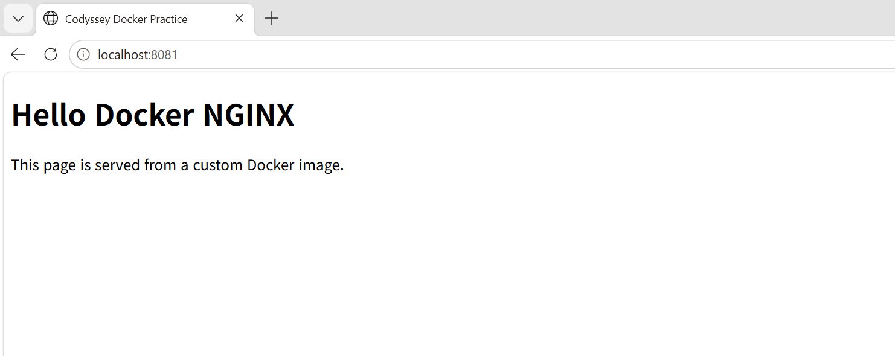
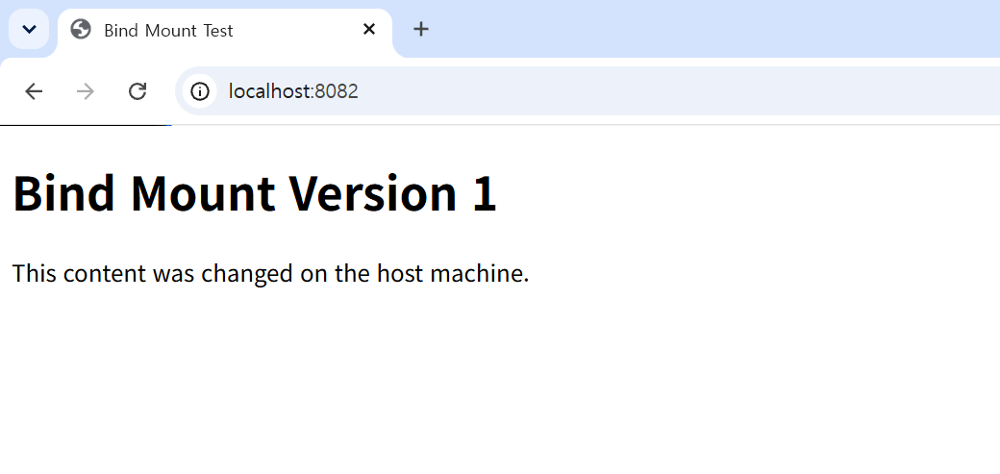
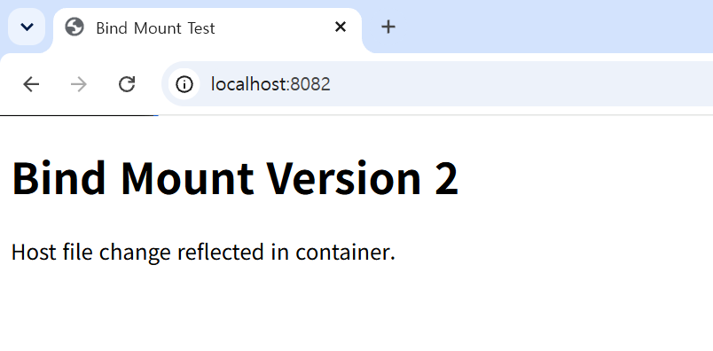
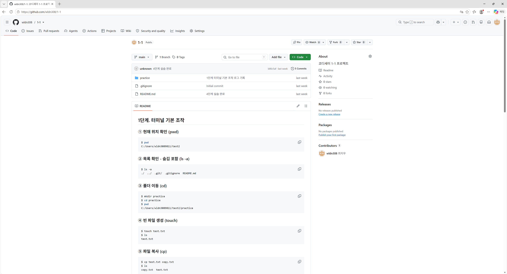
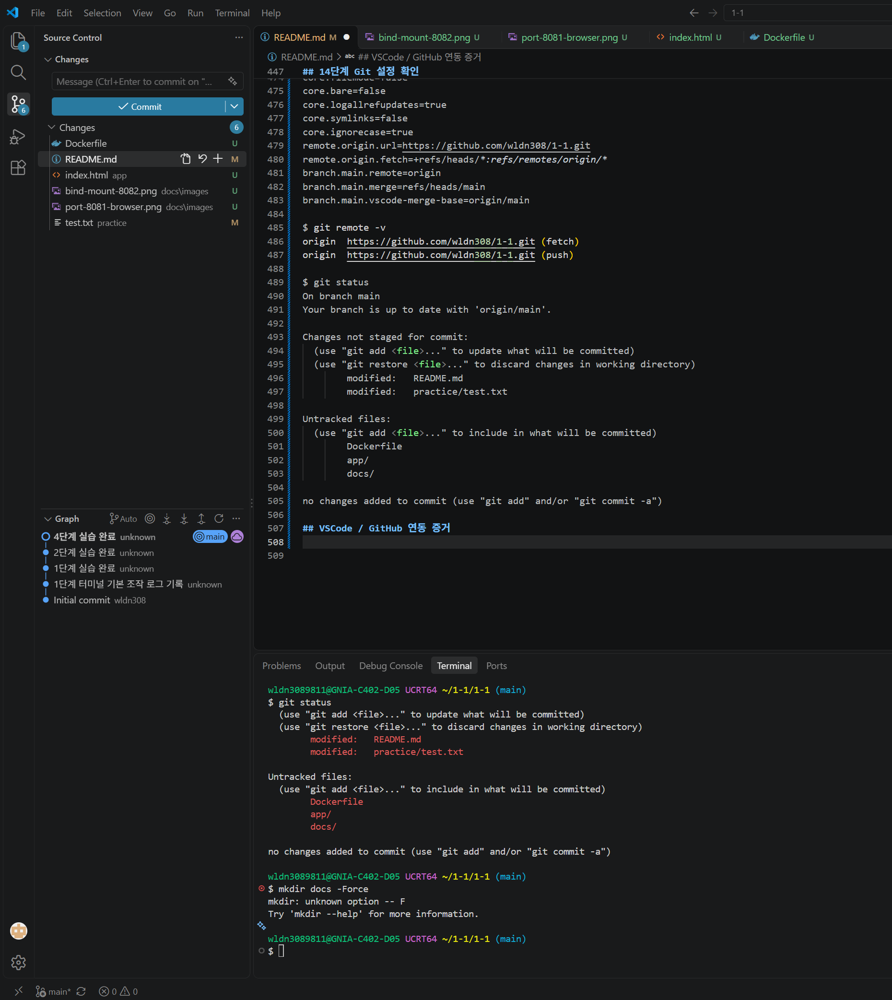
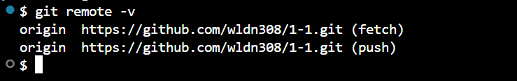

# 개발 워크스테이션 구축 과제

## 0. 프로젝트 개요

본 프로젝트는 개발 워크스테이션 구축 과제로, 개발 환경을 직접 구성하고 CLI 기반으로 주요 개발 도구를 검증하는 것을 목표로 한다.

수행한 주요 내용은 다음과 같다.

- 터미널 기본 명령어 실습
- 파일 및 디렉토리 권한 확인/변경 실습
- Docker 설치 및 데몬 동작 확인
- Docker 이미지/컨테이너 기본 운영 명령 실습
- `hello-world` 컨테이너 실행
- `ubuntu` 컨테이너 실행 및 내부 명령 수행
- Dockerfile을 이용한 NGINX 기반 커스텀 웹 서버 이미지 제작
- 포트 매핑을 통한 웹 서버 접속 확인
- 바인드 마운트를 통한 호스트 파일 변경 사항 반영 확인
- Docker 볼륨을 이용한 데이터 영속성 검증
- Git 설정 및 GitHub Repository 연동
- 수행 로그와 증거를 README 문서로 정리

모든 작업은 터미널 기반으로 수행했으며, 명령어와 핵심 출력 결과를 본 문서에 기록했다.

### GitHub Repository

- Repository: `https://github.com/wldn308/1-1`

### 0-1. 저장소 디렉토리 구조

```text
1-1/
├── README.md                    # 기술 문서 (모든 수행 로그와 증거의 진입점)
├── Dockerfile                   # 커스텀 NGINX 이미지 빌드 정의
├── .gitignore                   # Git 추적 제외 규칙 (.env, *.log 등)
├── app/
│   └── index.html               # 이미지에 COPY되는 웹 서버 정적 소스
├── bind-mount-test/
│   └── index.html               # 바인드 마운트 실습용 호스트 파일 (이미지에 포함되지 않음)
├── practice/
│   └── test.txt                 # 터미널 기본 조작 실습 결과물
└── docs/
    └── images/                  # README에 첨부한 스크린샷 증거
        ├── port-8081-browser.png   # 12-2 포트 매핑 브라우저 접속
        ├── bind-mount1.png         # 13-4 바인드 마운트 변경 전
        ├── bind-mount2.png         # 13-6 바인드 마운트 변경 후
        ├── vs-git1.png             # 16-6 VSCode Source Control
        ├── vs-git2.png             # 16-6 터미널 Git 확인
        └── vs-git3.png             # 16-6 GitHub 저장소 화면
```

실제 구조는 다음 명령으로 확인했다. (`tree` 명령이 없는 Git Bash 환경이므로 `find`를 사용하고, `.git` 내부는 제외)

```bash
$ find . -path ./.git -prune -o -print | sort
.
./.gitignore
./app
./app/index.html
./bind-mount-test
./bind-mount-test/index.html
./Dockerfile
./docs
./docs/images
./docs/images/bind-mount1.png
./docs/images/bind-mount2.png
./docs/images/port-8081-browser.png
./docs/images/vs-git1.png
./docs/images/vs-git2.png
./docs/images/vs-git3.png
./practice
./practice/test.txt
./README.md
```

#### 구성 기준과 폴더별 역할

| 경로 | 역할 | 이렇게 나눈 이유 |
|---|---|---|
| `/` (루트) | `README.md`, `Dockerfile`, `.gitignore` 배치 | 저장소를 받은 사람이 루트에서 바로 문서를 읽고 `docker build -t custom-nginx:1.0 .`을 실행할 수 있도록 빌드 컨텍스트를 루트로 통일 |
| `app/` | 이미지 안으로 복사되는 웹 소스 | 이미지에 들어가는 파일만 모아 두어 `COPY app/index.html ...` 한 줄로 범위를 명확히 하고, 실습 파일이 이미지에 섞이지 않게 함 |
| `bind-mount-test/` | 실행 중인 컨테이너에 바인드 마운트되는 호스트 폴더 | “이미지에 굽는 파일(`app/`)”과 “실행 시점에 연결하는 파일”을 분리해 두 방식의 차이를 폴더 단위로 구분 |
| `practice/` | 터미널 실습 결과물 | 실습 중 생성/삭제가 반복되는 파일을 한곳에 격리해 루트를 깨끗하게 유지. 권한 실습용 임시 파일(`permission.txt`, `permission-dir/`, `run.sh`)은 결과를 4장에 기록하고 저장소에는 포함하지 않았다. |
| `docs/images/` | 스크린샷 증거 | README에서 상대 경로(`docs/images/...`)로 참조하므로 저장소 어디서 열어도 이미지가 깨지지 않음 |

명명 규칙은 소문자와 하이픈(`bind-mount-test`, `permission-dir`)을 사용해 공백 때문에 경로를 따옴표로 감싸야 하는 상황을 피했다.

---

## 1. 수행 항목 체크리스트

| 구분 | 요구사항 | 검증 방법 (명령) | 완료 | 증거 위치 |
|---|---|---|---:|---|
| 프로젝트 개요 | 미션 목표 요약, 디렉토리 구조 | - | 완료 | [0. 프로젝트 개요](#0-프로젝트-개요), [0-1. 디렉토리 구조](#0-1-저장소-디렉토리-구조) |
| 실행 환경 | OS, 쉘, 터미널, Git, Docker 버전 | `uname -a`, `echo $SHELL`, `git --version`, `docker --version` | 완료 | [2. 실행 환경](#2-실행-환경) |
| 터미널 조작 | 위치 확인, 숨김 파일 포함 목록, 이동, 생성, 복사, 이름 변경, 삭제, 내용 확인, 빈 파일 생성 | `pwd`, `ls -a`, `cd`, `mkdir`, `touch`, `cp`, `mv`, `rm`, `cat` | 완료 | [3. 터미널 기본 조작 로그](#3-터미널-기본-조작-로그) |
| 경로 개념 | 절대/상대 경로 차이와 선택 기준 | 실습 로그의 경로 사용 사례 분석 | 완료 | [3-1. 절대 경로와 상대 경로](#3-1-절대-경로와-상대-경로) |
| 권한 실습 | 파일 1개, 디렉토리 1개 권한 변경 전/후 비교 | `ls -l`, `ls -ld`, `chmod` | 완료 | [4. 권한 실습](#4-권한-실습) |
| Docker 설치 점검 | CLI 버전, 데몬 동작 | `docker --version`, `docker info` | 완료 | [5. Docker 설치 및 기본 점검](#5-docker-설치-및-기본-점검) |
| Docker 기본 운영 | 이미지/컨테이너 목록, 로그, 리소스 | `docker images`, `docker ps`, `docker ps -a`, `docker logs`, `docker stats` | 완료 | [6. Docker 기본 운영 명령](#6-docker-기본-운영-명령) |
| hello-world | 컨테이너 실행 성공 | `docker run hello-world` | 완료 | [7. hello-world 컨테이너 실행](#7-hello-world-컨테이너-실행) |
| Ubuntu 컨테이너 | 내부 진입 후 명령 수행 | `docker run -it ubuntu bash` | 완료 | [8. Ubuntu 컨테이너 실습](#8-ubuntu-컨테이너-실습) |
| attach/exec 차이 | 컨테이너 종료/유지 차이 관찰 | `docker exec` 후 `exit`, `docker ps` | 완료 | [8-3. attach와 exec 차이 정리](#8-3-attach와-exec-차이-정리) |
| Dockerfile | 기존 NGINX 이미지 기반 커스텀 이미지 | `cat Dockerfile` | 완료 | [9. Dockerfile 기반 커스텀 이미지 제작](#9-dockerfile-기반-커스텀-이미지-제작) |
| 이미지 빌드 | 빌드 성공, 이미지와 컨테이너의 차이 | `docker build`, `docker images` | 완료 | [10. 커스텀 이미지 빌드](#10-커스텀-이미지-빌드), [10-2. 이미지와 컨테이너](#10-2-이미지와-컨테이너의-차이-저장-vs-실행) |
| 컨테이너 실행 | 커스텀 이미지 컨테이너 실행 | `docker run -d -p 8081:80`, `docker ps` | 완료 | [11. 커스텀 웹 서버 컨테이너 실행](#11-커스텀-웹-서버-컨테이너-실행) |
| 포트 매핑 | 호스트 8081 → 컨테이너 80 접속, 네트워크 격리 설명 | `curl http://localhost:8081`, 브라우저 | 완료 | [12. 포트 매핑 및 접속 확인](#12-포트-매핑-및-접속-확인) |
| 바인드 마운트 | 호스트 변경 전/후 컨테이너 반영 | `docker run -v`, `curl http://localhost:8082` | 완료 | [13. 바인드 마운트 검증](#13-바인드-마운트-검증) |
| Docker 볼륨 | 컨테이너 삭제 전/후 데이터 유지 | `docker volume create`, `docker run -v`, `cat` | 완료 | [14. Docker 볼륨 영속성 검증](#14-docker-볼륨-영속성-검증) |
| Git 설정 | 사용자 정보/기본 브랜치, Git과 GitHub 역할 | `git config --list` | 완료 | [15. Git 설정 확인](#15-git-설정-확인) |
| GitHub 연동 | 저장소 연동, push, VSCode 연동 | `git remote -v`, `git push`, 스크린샷 | 완료 | [16. GitHub 연동 및 업로드](#16-github-연동-및-업로드) |
| 보안 | 민감정보 마스킹, 토큰 미노출 | `git remote -v`, `grep .gitignore` | 완료 | [17. 보안 및 개인정보 보호](#17-보안-및-개인정보-보호) |
| 트러블슈팅 | 문제 → 원인 가설 → 확인 → 해결/대안 (7건, 실제 발생 2건 포함) | 각 사례별 확인 명령 | 완료 | [18. 트러블슈팅 기록](#18-트러블슈팅-기록) |

---

## 2. 실행 환경

| 항목 | 값 |
|---|---|
| OS | Windows (NT 10.0, build 26300) |
| Shell | bash (`/usr/bin/bash`) |
| Terminal | Git Bash (MINGW64) |
| Docker | Docker Desktop, Docker version 29.9.3 (WSL2 백엔드) |
| Git | git version 2.56.0.windows.4 |
| Editor | VSCode (`core.editor=code --wait`) |

### 2-1. OS 및 쉘 확인

```bash
$ uname -a
MINGW64_NT-10.0-26300 GNIA-C402-D05 3.6.10-5a1665c8.x86_64 2026-09-28 10:40 UTC x86_64 Msys

$ echo $SHELL
/usr/bin/bash
```

현재 작업 환경은 Windows에서 Git Bash를 사용하는 `MINGW64` 환경이다.

### 2-2. Git 버전 확인

```bash
$ git --version
git version 2.56.0.windows.4
```

Git 명령어가 정상적으로 실행되었으며, Git이 설치되어 있음을 확인했다.

### 2-3. Docker 버전 확인

```bash
$ docker --version
Docker version 29.9.3, build 5457199
```

Docker CLI가 정상적으로 설치되어 있음을 확인했다.

### 2-4. Docker 데몬 동작 확인

```bash
$ docker info
Client:
 Version:    29.9.3
 Context:    desktop-linux
 Debug Mode: false

Server:
 Containers: 0
  Running: 0
  Paused: 0
  Stopped: 0
 Images: 0
 Server Version: 29.9.3
 Storage Driver: overlayfs
 Cgroup Version: 2
 Kernel Version: 6.18.58.1-microsoft-standard-WSL2
 Operating System: Docker Desktop
 OSType: linux
 Architecture: x86_64
 CPUs: 24
 Total Memory: 15.25GiB
 Name: docker-desktop
 Debug Mode: false
```

`docker info` 명령이 정상적으로 출력되었으므로 Docker 데몬이 실행 중임을 확인했다.

---

## 3. 터미널 기본 조작 로그

현재 위치 확인, 숨김 파일 포함 목록 확인, 디렉토리 이동, 파일 생성, 파일 내용 확인, 복사, 이름 변경, 삭제를 터미널에서 수행했다.

```bash
$ pwd
/c/Users/<USER>/1-1/1-1

$ ls -a
./  ../  .git/  .gitignore  practice/  README.md

$ mkdir -p practice

$ cd practice

$ pwd
/c/Users/<USER>/1-1/1-1/practice

$ touch test.txt

$ ls
test.txt

$ echo "hello codyssey" > test.txt

$ cat test.txt
hello codyssey

$ cp test.txt copy.txt

$ ls
copy.txt  test.txt

$ mv copy.txt renamed.txt

$ ls
renamed.txt  test.txt

$ rm renamed.txt

$ ls
test.txt

$ cd ..

$ pwd
/c/Users/<USER>/1-1/1-1
```

### 터미널 명령어별 확인 내용

| 명령어 | 수행 내용 |
|---|---|
| `pwd` | 현재 작업 위치 확인 |
| `ls -a` | 숨김 파일을 포함한 파일 목록 확인 |
| `mkdir -p practice` | 실습용 디렉토리 생성 |
| `cd practice` | 생성한 디렉토리로 이동 |
| `touch test.txt` | 빈 파일 생성 |
| `echo "hello codyssey" > test.txt` | 파일에 문자열 작성 |
| `cat test.txt` | 파일 내용 출력 |
| `cp test.txt copy.txt` | 파일 복사 |
| `mv copy.txt renamed.txt` | 파일 이름 변경 |
| `rm renamed.txt` | 파일 삭제 |
| `cd ..` | 상위 디렉토리로 이동 |

터미널 기본 명령어를 사용하여 파일과 디렉토리를 생성, 확인, 복사, 이름 변경, 삭제하는 과정을 수행했다.

---

### 3-1. 절대 경로와 상대 경로

| 구분 | 기준점 | 이번 실습에서의 예시 |
|---|---|---|
| 절대 경로 | 항상 루트(`/`)에서 시작 | `pwd` 출력 `/c/Users/<USER>/1-1/1-1/practice`, 컨테이너 내부 `/usr/share/nginx/html`, `/data/message.txt` |
| 상대 경로 | 현재 작업 디렉토리(`pwd`)에서 시작 | `cd practice`, `cd ..`, `./run.sh`, Dockerfile의 `COPY app/index.html`, README의 `docs/images/...` |

같은 파일도 위치에 따라 표현이 달라진다. 저장소 루트에서 `practice/test.txt`는 상대 경로이고, 어디서든 통하는 절대 경로는 `/c/Users/<USER>/1-1/1-1/practice/test.txt`이다. `practice/` 안으로 이동하면 상대 경로는 `test.txt`로 바뀌지만 절대 경로는 그대로다.

#### 언제 어느 것을 쓰는가 (선택 기준)

| 상황 | 선택 | 이유 |
|---|---|---|
| 저장소 안의 파일끼리 참조 (Dockerfile `COPY`, README 이미지 링크) | 상대 경로 | 저장소를 다른 PC·다른 폴더에 clone해도 그대로 동작한다. 절대 경로를 쓰면 내 PC의 사용자명이 박혀 다른 사람에게서는 깨진다. |
| 컨테이너 내부 경로 (`/usr/share/nginx/html`, `/data`) | 절대 경로 | 컨테이너의 작업 디렉토리가 이미지마다 다르므로, 기준점이 고정된 절대 경로를 써야 의도한 위치에 정확히 연결된다. |
| `docker run -v`의 호스트 쪽 경로 | 절대 경로 (단, `"$(pwd)"`로 생성) | Docker는 `/`로 시작하지 않는 값을 볼륨 이름으로 해석하므로 바인드 마운트에는 절대 경로가 필요하다. 다만 사용자명을 하드코딩하지 않도록 `"$(pwd)"`로 현재 위치를 절대 경로로 펼쳐 쓰면 재현성과 개인정보 보호를 모두 지킬 수 있다. |
| 스크립트·cron 등 실행 위치가 일정하지 않은 작업 | 절대 경로 | 실행 시점의 현재 디렉토리에 따라 상대 경로가 엉뚱한 곳을 가리킬 수 있다. |
| 터미널에서의 일상적인 이동 | 상대 경로 | 짧고 빠르며, 현재 위치를 기준으로 생각하기 쉽다. |

---

## 4. 권한 실습

파일과 디렉토리에 대해 `chmod` 명령을 사용하여 권한을 변경했다.

Windows Git Bash 환경에서는 Windows 파일 시스템 특성상 Linux 권한 모델이 완전히 동일하게 반영되지 않을 수 있으므로, Docker Ubuntu 컨테이너 내부에서도 권한 변경 결과를 추가로 확인했다.

---

### 4-1. 파일 권한 변경

```bash
$ cd practice

$ touch permission.txt

$ ls -l permission.txt
-rw-r--r-- 1 <USER> <GROUP> 0 <DATE> permission.txt

$ chmod 600 permission.txt

$ ls -l permission.txt
-rw------- 1 <USER> <GROUP> 0 <DATE> permission.txt
```

`chmod 600 permission.txt` 명령으로 파일 권한을 변경했다.

| 권한 값 | 의미 |
|---|---|
| `6` | 소유자 읽기 + 쓰기 |
| `0` | 그룹 권한 없음 |
| `0` | 기타 사용자 권한 없음 |

따라서 `600`은 소유자만 읽고 쓸 수 있는 권한인 `rw-------`를 의미한다.

---

### 4-2. 디렉토리 권한 변경

```bash
$ mkdir permission-dir

$ ls -ld permission-dir
drwxr-xr-x 1 <USER> <GROUP> 0 <DATE> permission-dir

$ chmod 700 permission-dir

$ ls -ld permission-dir
drwx------ 1 <USER> <GROUP> 0 <DATE> permission-dir
```

`chmod 700 permission-dir` 명령으로 디렉토리 권한을 변경했다.

| 권한 값 | 의미 |
|---|---|
| `7` | 소유자 읽기 + 쓰기 + 실행 |
| `0` | 그룹 권한 없음 |
| `0` | 기타 사용자 권한 없음 |

디렉토리에서 실행 권한은 해당 디렉토리로 진입할 수 있는 권한을 의미한다.

---

### 4-3. 실행 파일 권한 변경

```bash
$ echo "echo permission test" > run.sh

$ chmod 755 run.sh

$ ls -l run.sh
-rwxr-xr-x 1 <USER> <GROUP> <SIZE> <DATE> run.sh

$ ./run.sh
permission test
```

`chmod 755 run.sh` 명령으로 스크립트 파일에 실행 권한을 부여했다.

| 권한 값 | 의미 |
|---|---|
| `7` | 소유자 읽기 + 쓰기 + 실행 |
| `5` | 그룹 읽기 + 실행 |
| `5` | 기타 사용자 읽기 + 실행 |

실행 권한을 부여한 뒤 `./run.sh` 명령으로 스크립트가 정상 실행되는 것을 확인했다.

---

### 4-4. Ubuntu 컨테이너 내부에서 권한 검증

Windows Git Bash의 권한 표시 차이를 보완하기 위해 Linux 환경인 Ubuntu 컨테이너 내부에서 `chmod` 결과를 추가 확인했다.

```bash
$ docker run --rm ubuntu bash -c "touch /tmp/test.txt && chmod 600 /tmp/test.txt && ls -l /tmp/test.txt"
-rw------- 1 root root 0 <DATE> /tmp/test.txt
```

파일 권한이 `rw-------`로 변경되었음을 확인했다.

```bash
$ docker run --rm ubuntu bash -c "mkdir /tmp/testdir && chmod 700 /tmp/testdir && ls -ld /tmp/testdir"
drwx------ 2 root root <SIZE> <DATE> /tmp/testdir
```

디렉토리 권한이 `rwx------`로 변경되었음을 확인했다.

```bash
$ docker run --rm ubuntu bash -c "echo 'echo hello' > /tmp/run.sh && chmod 755 /tmp/run.sh && ls -l /tmp/run.sh && /tmp/run.sh"
-rwxr-xr-x 1 root root <SIZE> <DATE> /tmp/run.sh
hello
```

Linux 컨테이너 내부에서는 `chmod` 명령에 따른 권한 변경이 정상적으로 반영되는 것을 확인했다.

---

### 4-5. 권한 변경 전/후 요약

| 대상 | 변경 전 | 명령 | 변경 후 |
|---|---|---|---|
| 파일 `permission.txt` | `-rw-r--r--` (644) | `chmod 600` | `-rw-------` (600) |
| 디렉토리 `permission-dir` | `drwxr-xr-x` (755) | `chmod 700` | `drwx------` (700) |
| 스크립트 `run.sh` | 실행 권한 없음 | `chmod 755` | `-rwxr-xr-x` (755) |

---

### 4-6. r/w/x와 숫자 표기 해석 규칙

`ls -l` 출력의 첫 글자는 종류(`-` 파일, `d` 디렉토리)이고, 나머지 9글자는 3글자씩 **소유자(user) / 그룹(group) / 기타(others)** 권한이다.

| 문자 | 값 | 파일에서의 의미 | 디렉토리에서의 의미 |
|---|---:|---|---|
| `r` | 4 | 내용 읽기 | 목록 보기 (`ls`) |
| `w` | 2 | 내용 수정 | 안에서 파일 생성·삭제·이름 변경 |
| `x` | 1 | 프로그램으로 실행 | 진입 (`cd`) 및 내부 파일 접근 |
| `-` | 0 | 권한 없음 | 권한 없음 |

각 자리의 숫자는 해당 그룹의 값을 더한 것이다.

| 표기 | 소유자 | 그룹 | 기타 | 대표 용도 |
|---|---|---|---|---|
| `644` | `rw-` (4+2) | `r--` (4) | `r--` (4) | 일반 파일 기본값: 나만 수정, 모두 읽기 |
| `755` | `rwx` (4+2+1) | `r-x` (4+1) | `r-x` (4+1) | 디렉토리·실행 스크립트: 나만 수정, 모두 실행/진입 |
| `600` | `rw-` | `---` | `---` | 개인 키·설정 파일처럼 나만 봐야 하는 파일 |
| `700` | `rwx` | `---` | `---` | 나만 들어갈 수 있는 개인 디렉토리 |

계산 예시: `rw-r-----` → 소유자 `rw-`=4+2=6, 그룹 `r--`=4, 기타 `---`=0 → **640**.

---

## 5. Docker 설치 및 기본 점검

Docker Desktop 설치 후 Docker CLI와 Docker 데몬이 정상적으로 동작하는지 확인했다.

### 5-1. Docker Desktop 설치 확인

Docker Desktop을 설치하고 실행한 뒤, WSL2 기반 Docker Engine이 동작하는 것을 확인했다.

| 항목 | 상태 |
|---|---|
| Docker Desktop | 설치 완료 |
| Docker Engine | 실행 확인 |
| Docker Context | `desktop-linux` |
| WSL2 기반 실행 | 확인 |
| Operating System | Docker Desktop |

---

### 5-2. Docker 버전 확인

```bash
$ docker --version
Docker version 29.9.3, build 5457199
```

Docker CLI가 정상적으로 설치되어 있음을 확인했다.

---

### 5-3. Docker 데몬 정보 확인

```bash
$ docker info
Client:
 Version:    29.9.3
 Context:    desktop-linux
 Debug Mode: false

Server:
 Containers: 0
  Running: 0
  Paused: 0
  Stopped: 0
 Images: 0
 Server Version: 29.9.3
 Storage Driver: overlayfs
 Cgroup Version: 2
 Kernel Version: 6.18.58.1-microsoft-standard-WSL2
 Operating System: Docker Desktop
 OSType: linux
 Architecture: x86_64
 CPUs: 24
 Total Memory: 15.25GiB
 Name: docker-desktop
 Debug Mode: false
```

`docker info` 명령을 통해 Docker Client와 Server 정보가 출력되었다.

이를 통해 Docker CLI뿐 아니라 Docker 데몬도 정상적으로 실행 중임을 확인했다.

---

## 6. Docker 기본 운영 명령

Docker 이미지 목록, 컨테이너 목록, 로그, 리소스 사용량을 확인하는 기본 운영 명령을 수행했다.

---

### 6-1. Docker 이미지 목록 확인

```bash
$ docker images
IMAGE   ID   DISK USAGE   CONTENT SIZE   EXTRA
```

로컬에 저장된 Docker 이미지 목록을 확인했다.

Docker 29 버전의 `docker images`는 이전 버전(`REPOSITORY / TAG / IMAGE ID / CREATED / SIZE`)과 달리 `IMAGE / ID / DISK USAGE / CONTENT SIZE / EXTRA` 형식으로 출력된다. `DISK USAGE`는 압축을 푼 실제 디스크 사용량이고, `CONTENT SIZE`는 레지스트리에서 받는 압축된 이미지 크기이다.

초기 상태에서는 이미지가 없거나, 이전 실습에서 받은 이미지가 표시될 수 있다.

---

### 6-2. 실행 중인 컨테이너 목록 확인

```bash
$ docker ps
CONTAINER ID   IMAGE     COMMAND   CREATED   STATUS    PORTS     NAMES
```

현재 실행 중인 컨테이너 목록을 확인했다.

실행 중인 컨테이너가 없는 경우 목록에 컨테이너가 표시되지 않는다.

---

### 6-3. 전체 컨테이너 목록 확인

```bash
$ docker ps -a
CONTAINER ID   IMAGE     COMMAND   CREATED   STATUS    PORTS     NAMES
```

`docker ps -a` 명령으로 실행 중인 컨테이너와 중지된 컨테이너를 모두 확인했다.

---

### 6-4. Docker 로그 확인

[11장](#11-커스텀-웹-서버-컨테이너-실행)에서 실행한 `custom-nginx-container`에 `curl http://localhost:8081`로 한 번 접속한 뒤 로그를 확인했다.

```bash
$ docker logs custom-nginx-container
/docker-entrypoint.sh: /docker-entrypoint.d/ is not empty, will attempt to perform configuration
/docker-entrypoint.sh: Looking for shell scripts in /docker-entrypoint.d/
/docker-entrypoint.sh: Launching /docker-entrypoint.d/10-listen-on-ipv6-by-default.sh
10-listen-on-ipv6-by-default.sh: info: Getting the checksum of /etc/nginx/conf.d/default.conf
10-listen-on-ipv6-by-default.sh: info: Enabled listen on IPv6 in /etc/nginx/conf.d/default.conf
/docker-entrypoint.sh: Sourcing /docker-entrypoint.d/15-local-resolvers.envsh
/docker-entrypoint.sh: Launching /docker-entrypoint.d/20-envsubst-on-templates.sh
/docker-entrypoint.sh: Launching /docker-entrypoint.d/30-tune-worker-processes.sh
/docker-entrypoint.sh: Configuration complete; ready for start up
2026/11/17 03:12:19 [notice] 1#1: using the "epoll" event method
2026/11/17 03:12:19 [notice] 1#1: nginx/1.31.8
2026/11/17 03:12:19 [notice] 1#1: built by gcc 15.2.0 (Alpine 15.2.0)
2026/11/17 03:12:19 [notice] 1#1: OS: Linux 6.18.58.1-microsoft-standard-WSL2
2026/11/17 03:12:19 [notice] 1#1: getrlimit(RLIMIT_NOFILE): 1048576:1048576
2026/11/17 03:12:19 [notice] 1#1: start worker processes
2026/11/17 03:12:19 [notice] 1#1: start worker process 30
2026/11/17 03:12:19 [notice] 1#1: start worker process 31
... (start worker process 32 ~ 52 생략)
2026/11/17 03:12:19 [notice] 1#1: start worker process 53
172.17.0.1 - - [17/Nov/2026:03:12:25 +0000] "GET / HTTP/1.1" 200 223 "-" "curl/8.23.0" "-"
```

| 로그 구간 | 의미 |
|---|---|
| `/docker-entrypoint.sh: ...` | NGINX 공식 이미지의 시작 스크립트가 설정을 마치고 `ready for start up` 상태가 됨 |
| `[notice] ... nginx/1.31.8`, `start worker process` | NGINX 마스터 프로세스(PID 1)가 시작되어 요청을 처리할 워커 프로세스를 생성함 |
| `"GET / HTTP/1.1" 200 223 ... "curl/8.23.0"` | `curl` 요청이 컨테이너에 도착해 **200(성공)** 으로 223바이트(`index.html`)를 응답함 |

`docker logs`는 컨테이너의 메인 프로세스가 표준 출력/표준 에러로 남긴 내용을 보여준다. 마지막 접근 로그 한 줄로 12장의 포트 매핑 접속이 실제로 컨테이너까지 도달했음을 확인할 수 있다. (`hello-world` 컨테이너의 로그는 [7-2](#7-2-hello-world-로그-확인) 참고)

---

### 6-5. Docker 리소스 사용량 확인

`custom-nginx-container`가 실행 중인 상태에서 리소스 사용량을 확인했다.

```bash
$ docker stats --no-stream
CONTAINER ID   NAME                     CPU %     MEM USAGE / LIMIT     MEM %     NET I/O           BLOCK I/O     PIDS
85c256bbc40f   custom-nginx-container   0.00%     21.16MiB / 15.25GiB   0.14%     2.33kB / 1.01kB   0B / 8.19kB   25
```

| 항목 | 값 | 해석 |
|---|---|---|
| `CPU %` | 0.00% | 요청이 없는 대기 상태라 CPU를 거의 쓰지 않음 |
| `MEM USAGE / LIMIT` | 21.16MiB / 15.25GiB | 실제 사용 21MiB. 한도 15.25GiB는 `docker info`의 `Total Memory`와 같음 (메모리 제한을 따로 걸지 않았기 때문) |
| `NET I/O` | 2.33kB / 1.01kB | 컨테이너가 받은/보낸 데이터. `curl` 요청과 응답이 반영됨 |
| `PIDS` | 25 | NGINX 마스터 1개 + 워커 프로세스 24개 (6-4 로그의 `start worker process 30~53`) |

`--no-stream` 옵션을 빼면 실시간으로 계속 갱신되므로, 기록용으로는 1회만 출력하도록 `--no-stream`을 사용했다. 실행 중인 컨테이너가 없으면 헤더만 출력된다.

---

### 6-6. Docker 기본 운영 명령 요약

| 명령어 | 설명 |
|---|---|
| `docker images` | 로컬 이미지 목록 확인 |
| `docker ps` | 실행 중인 컨테이너 목록 확인 |
| `docker ps -a` | 중지된 컨테이너를 포함한 전체 컨테이너 목록 확인 |
| `docker logs <container>` | 컨테이너 로그 확인 |
| `docker stats --no-stream` | 컨테이너 리소스 사용량 1회 확인 |

---

## 7. hello-world 컨테이너 실행

Docker가 정상적으로 이미지를 내려받고 컨테이너를 실행할 수 있는지 확인하기 위해 `hello-world` 이미지를 실행했다.

```bash
$ docker run hello-world

Hello from Docker!
This message shows that your installation appears to be working correctly.
```

`Hello from Docker!` 메시지가 출력되었으므로 Docker 컨테이너 실행이 정상적으로 동작함을 확인했다.

### 7-1. hello-world 실행 후 컨테이너 목록 확인

```bash
$ docker ps -a
CONTAINER ID   IMAGE         COMMAND    CREATED          STATUS                      PORTS     NAMES
<CONTAINER_ID> hello-world   "/hello"   <CREATED_TIME>   Exited (0) <TIME_AGO>                 <CONTAINER_NAME>
```

`hello-world` 컨테이너는 실행 후 메시지를 출력하고 종료되는 구조이므로, `docker ps`에는 표시되지 않고 `docker ps -a`에서 종료된 컨테이너로 확인된다.

### 7-2. hello-world 로그 확인

```bash
$ docker logs <CONTAINER_ID>
Hello from Docker!
This message shows that your installation appears to be working correctly.
```

`docker logs` 명령을 통해 `hello-world` 컨테이너의 출력 내용을 다시 확인했다.

---

## 8. Ubuntu 컨테이너 실습

Ubuntu 이미지를 사용하여 Linux 컨테이너를 실행하고, 컨테이너 내부에서 기본 명령어를 수행했다.

---

### 8-1. Ubuntu 컨테이너 1회 실행

```bash
$ docker run ubuntu echo "hello ubuntu"
Unable to find image 'ubuntu:latest' locally
latest: Pulling from library/ubuntu
Digest: sha256:<DIGEST>
Status: Downloaded newer image for ubuntu:latest
hello ubuntu
```

로컬에 `ubuntu` 이미지가 없었기 때문에 Docker Hub에서 이미지를 내려받은 후 컨테이너가 실행되었다.

`hello ubuntu`가 출력되었으므로 Ubuntu 컨테이너가 정상적으로 실행됨을 확인했다.

---

### 8-2. Ubuntu 컨테이너 내부 명령 수행

```bash
$ docker run -it ubuntu bash
root@<CONTAINER_ID>:/# pwd
/

root@<CONTAINER_ID>:/# ls
bin  boot  dev  etc  home  lib  lib64  media  mnt  opt  proc  root  run  sbin  srv  sys  tmp  usr  var

root@<CONTAINER_ID>:/# cat /etc/os-release
PRETTY_NAME="Ubuntu <VERSION>"
NAME="Ubuntu"
ID=ubuntu

root@<CONTAINER_ID>:/# exit
exit
```

`docker run -it ubuntu bash` 명령으로 Ubuntu 컨테이너 내부에 진입했다.

컨테이너 내부에서 다음 내용을 확인했다.

| 명령어 | 확인 내용 |
|---|---|
| `pwd` | 현재 위치가 루트 디렉토리 `/`임을 확인 |
| `ls` | Ubuntu 파일 시스템 구조 확인 |
| `cat /etc/os-release` | Ubuntu 운영체제 정보 확인 |
| `exit` | 컨테이너 내부 쉘 종료 |

---

### 8-3. attach와 exec 차이 정리

Docker 컨테이너 내부에 접근하는 방식으로 `attach`와 `exec`가 있다.

| 구분 | `docker attach` | `docker exec` |
|---|---|---|
| 목적 | 실행 중인 컨테이너의 메인 프로세스에 연결 | 실행 중인 컨테이너에 새 명령 실행 |
| 연결 대상 | 컨테이너의 기존 표준 입출력 | 컨테이너 내부의 새 프로세스 |
| 종료 영향 | 쉘에서 `exit`하면 컨테이너가 종료될 수 있음 | `exit`해도 컨테이너의 메인 프로세스는 유지됨 |
| 주 사용 상황 | 컨테이너의 기존 터미널에 붙을 때 | 실행 중인 컨테이너 내부에서 추가 명령을 실행할 때 |

실습에서는 실행 중인 컨테이너를 유지한 상태에서 내부 명령을 수행하기 위해 `docker exec` 방식이 더 안전하다는 것을 확인했다.

---

### 8-4. 실행 중인 Ubuntu 컨테이너에 exec로 접속

먼저 Ubuntu 컨테이너를 백그라운드에서 실행했다.

```bash
$ docker run -dit --name ubuntu-practice ubuntu bash
<CONTAINER_ID>
```

실행 중인 컨테이너 목록을 확인했다.

```bash
$ docker ps
CONTAINER ID   IMAGE     COMMAND   CREATED          STATUS          PORTS     NAMES
<CONTAINER_ID> ubuntu    "bash"    <CREATED_TIME>   Up <TIME>                 ubuntu-practice
```

`docker exec` 명령으로 실행 중인 컨테이너 내부에 접속했다.

```bash
$ docker exec -it ubuntu-practice bash
root@<CONTAINER_ID>:/# echo "exec test"
exec test

root@<CONTAINER_ID>:/# exit
exit
```

`exec`로 접속한 쉘에서 `exit`를 실행해도 컨테이너 자체는 계속 실행 중임을 확인했다.

```bash
$ docker ps
CONTAINER ID   IMAGE     COMMAND   CREATED          STATUS          PORTS     NAMES
<CONTAINER_ID> ubuntu    "bash"    <CREATED_TIME>   Up <TIME>                 ubuntu-practice
```

실습 후 컨테이너를 정리했다.

```bash
$ docker stop ubuntu-practice
ubuntu-practice

$ docker rm ubuntu-practice
ubuntu-practice
```

---

## 9. Dockerfile 기반 커스텀 이미지 제작

NGINX 공식 이미지를 기반으로 커스텀 웹 페이지를 제공하는 Docker 이미지를 제작했다.

### 선택한 방식과 베이스

| 항목 | 내용 |
|---|---|
| 선택 방식 | (A) 웹 서버 베이스 이미지 활용 + 정적 콘텐츠 교체 |
| 기존 베이스 이미지 | `nginx:alpine` (Docker Hub 공식 NGINX 이미지의 Alpine Linux 기반 경량 버전) |
| 선택 이유 | 웹 서버 설치·설정이 이미 완료된 공식 이미지를 재사용해, 내가 바꿔야 할 부분(콘텐츠)에만 집중할 수 있다. Alpine 기반이라 이미지 크기가 작아 pull/빌드가 빠르다. |

---

### 9-1. 웹 소스 디렉토리 생성

저장소 루트에서 이미지에 포함할 웹 소스를 `app/` 디렉토리에 분리했다. (구성 이유는 [0-1. 디렉토리 구조](#0-1-저장소-디렉토리-구조) 참고)

```bash
$ pwd
/c/Users/<USER>/1-1/1-1

$ mkdir -p app
```

---

### 9-2. app/index.html 작성

```bash
$ cat > app/index.html <<'EOF'
<!DOCTYPE html>
<html>
<head>
    <meta charset="UTF-8">
    <title>Codyssey Docker Practice</title>
</head>
<body>
    <h1>Hello Docker NGINX</h1>
    <p>This page is served from a custom Docker image.</p>
</body>
</html>
EOF
```

NGINX에서 제공할 기본 웹 페이지인 `app/index.html` 파일을 작성했다.

---

### 9-3. Dockerfile 작성

```bash
$ cat > Dockerfile <<'EOF'
FROM nginx:alpine

COPY app/index.html /usr/share/nginx/html/index.html

EXPOSE 80
EOF
```

### 9-4. 커스텀 포인트와 목적

| 구문 | 의미 | 커스텀 목적 |
|---|---|---|
| `FROM nginx:alpine` | 경량 NGINX 이미지를 기반 이미지로 사용 | 웹 서버를 직접 설치하지 않고 검증된 공식 이미지를 재사용 |
| `COPY app/index.html /usr/share/nginx/html/index.html` | 빌드 컨텍스트의 `app/index.html`을 NGINX 기본 웹 루트로 복사 | NGINX 기본 환영 페이지를 내 콘텐츠로 교체해, 이 이미지만으로 내 페이지가 서비스되도록 함 |
| `EXPOSE 80` | 컨테이너가 80번 포트를 사용함을 문서화 | 이미지 사용자가 어떤 포트를 `-p`로 연결해야 하는지 알 수 있게 함 (실제 포트 공개는 `docker run -p`가 담당) |

### 9-5. Dockerfile 확인

```bash
$ cat Dockerfile
FROM nginx:alpine

COPY app/index.html /usr/share/nginx/html/index.html

EXPOSE 80
```

Dockerfile이 정상적으로 작성되었음을 확인했다.

---

## 10. 커스텀 이미지 빌드

작성한 Dockerfile을 기반으로 커스텀 Docker 이미지를 빌드했다. 빌드는 `Dockerfile`이 있는 저장소 루트에서 실행하며, 마지막 인자 `.`은 현재 디렉토리를 빌드 컨텍스트로 사용한다는 뜻이다.

```bash
$ docker build -t custom-nginx:1.0 .
[+] Building 3.4s (7/7) FINISHED
 => [internal] load build definition from Dockerfile
 => => transferring dockerfile: 123B
 => [internal] load metadata for docker.io/library/nginx:alpine
 => [internal] load .dockerignore
 => => transferring context: 2B
 => [internal] load build context
 => => transferring context: 293B
 => [1/2] FROM docker.io/library/nginx:alpine@sha256:fed7e14be83cbd2661a75cdc5b872d936cf155d46c327084d30b8df19ae88d72
 => => resolve docker.io/library/nginx:alpine@sha256:fed7e14be83cbd2661a75cdc5b872d936cf155d46c327084d30b8df19ae88d72
 => => sha256:da90db506dd5... 20.55MB / 20.55MB
 ... (베이스 이미지 레이어 8개 다운로드 및 압축 해제 로그 생략)
 => [2/2] COPY app/index.html /usr/share/nginx/html/index.html
 => exporting to image
 => => exporting layers
 => => exporting manifest sha256:b08f74023cac2d54fcec1f86731461f34fa7e5ab6b5411a638e8c58dbe9a5e2e
 => => exporting config sha256:dde91f088f4fa2a7aebcddb73b3d95c1ec4a6febba5ad5ed3ae708e420d5314a
 => => exporting attestation manifest sha256:77290a448afb92b206a875d4856cea9111b5884dd5bd681c17f1f70f5cc9259d
 => => exporting manifest list sha256:6be4891b35083108fbf9acf783d087784edb41a1773131355f0feeae5553b36a
 => => naming to docker.io/library/custom-nginx:1.0
 => => unpacking to docker.io/library/custom-nginx:1.0
```

| 빌드 단계 | 의미 |
|---|---|
| `transferring context: 293B` | 빌드 컨텍스트(`.`)에서 `COPY`에 필요한 `app/index.html`(293바이트)만 Docker 엔진으로 전송 |
| `[1/2] FROM ...nginx:alpine` | 베이스 이미지를 받아 레이어로 사용 (로컬에 없어서 레이어 8개를 다운로드) |
| `[2/2] COPY app/index.html ...` | 내 웹 페이지를 새 레이어로 추가 → 커스텀 포인트 |
| `naming to .../custom-nginx:1.0` | 완성된 이미지에 `custom-nginx:1.0` 태그 부여 |

`custom-nginx:1.0` 이름의 커스텀 이미지가 생성되었다.

### 10-1. 이미지 목록 확인

```bash
$ docker images custom-nginx
IMAGE              ID             DISK USAGE   CONTENT SIZE   EXTRA
custom-nginx:1.0   6be4891b3508   93.7MB       26.4MB
```

이미지 목록에서 `custom-nginx:1.0` 이미지가 생성된 것을 확인했다. `ID` 값 `6be4891b3508`은 빌드 로그 마지막의 `exporting manifest list sha256:6be4891b3508...`과 일치하므로, 방금 빌드한 이미지임을 추적할 수 있다.

---

### 10-2. 이미지와 컨테이너의 차이 (저장 vs 실행)

| 구분 | 이미지 (Image) | 컨테이너 (Container) |
|---|---|---|
| 정체 | 실행에 필요한 파일·설정을 묶은 **읽기 전용 템플릿** | 이미지를 바탕으로 만든 **실행 중인(또는 멈춘) 인스턴스** |
| 상태 | 저장된 결과물. 빌드 후에는 바뀌지 않음 (불변) | 프로세스가 돌아가며 상태가 바뀜 (Up / Exited) |
| 저장 방식 | 레이어들의 묶음 (`nginx:alpine` 레이어 + `COPY` 레이어) | 이미지 레이어 위에 **쓰기 가능한 레이어 1개**를 얹은 형태 |
| 생성 명령 | `docker build`, `docker pull` | `docker run`, `docker create` |
| 확인 명령 | `docker images` | `docker ps`, `docker ps -a` |
| 삭제 명령 | `docker rmi` | `docker rm` |
| 비유 | 설계도, 클래스 | 설계도로 지은 집, 객체(인스턴스) |

#### 이번 실습에서 관찰한 사례

1. **하나의 이미지 → 여러 컨테이너**: `nginx:alpine` 이미지 하나는 `custom-nginx:1.0`의 베이스가 되었고, 13장에서는 `bind-nginx` 컨테이너로도 직접 실행되었다.
2. **컨테이너를 지워도 이미지는 남는다**: 8-1에서 `ubuntu` 이미지를 처음 받을 때는 `Pulling from library/ubuntu` 다운로드 로그가 출력되었다. 이후 8-4에서 `docker rm ubuntu-practice`로 컨테이너를 삭제했지만, 14장에서 다시 `docker run ... ubuntu`를 실행했을 때는 다운로드 없이 바로 실행되었다. 컨테이너만 지워졌을 뿐 이미지는 로컬에 저장되어 있기 때문이다.
3. **실행이 끝나도 컨테이너는 남는다**: 7-1에서 `hello-world` 컨테이너는 출력 후 `Exited (0)` 상태로 `docker ps -a`에 남았다. 실행 단위(컨테이너)는 프로세스가 끝나면 멈출 뿐, 지우기 전까지는 기록이 남는다.
4. **컨테이너 안의 변경은 이미지에 반영되지 않는다**: 컨테이너 내부에서 만든 파일은 그 컨테이너의 쓰기 레이어에만 존재하며, 컨테이너를 삭제하면 함께 사라진다. 이 때문에 지속해야 하는 데이터는 14장의 Docker 볼륨에 저장한다. 웹 페이지를 바꾸려면 이미지를 다시 빌드해야 하는 것도 같은 이유이다.
5. **반대로 이미지가 없으면 실행 단위도 만들 수 없다**: 18-1에서 `custom-nginx:1.0` 이미지가 로컬에 없어 `docker run`이 실패했다. 컨테이너는 반드시 저장된 이미지로부터 만들어진다.

---

## 11. 커스텀 웹 서버 컨테이너 실행

빌드한 `custom-nginx:1.0` 이미지를 사용하여 웹 서버 컨테이너를 실행했다.

```bash
$ docker run -d --name custom-nginx-container -p 8081:80 custom-nginx:1.0
<CONTAINER_ID>
```

옵션의 의미는 다음과 같다.

| 옵션 | 의미 |
|---|---|
| `-d` | 컨테이너를 백그라운드에서 실행 |
| `--name custom-nginx-container` | 컨테이너 이름 지정 |
| `-p 8081:80` | 호스트의 8081 포트를 컨테이너의 80 포트에 연결 |
| `custom-nginx:1.0` | 실행할 이미지 이름과 태그 |

### 11-1. 실행 중인 컨테이너 확인

```bash
$ docker ps
CONTAINER ID   IMAGE              COMMAND                  CREATED          STATUS          PORTS                  NAMES
<CONTAINER_ID> custom-nginx:1.0    "/docker-entrypoint.…"   <CREATED_TIME>   Up <TIME>       0.0.0.0:8081->80/tcp   custom-nginx-container
```

`custom-nginx-container` 컨테이너가 실행 중이며, 호스트 8081 포트가 컨테이너 80 포트로 매핑된 것을 확인했다.

---

## 12. 포트 매핑 및 접속 확인

호스트의 8081 포트를 통해 컨테이너 내부의 NGINX 웹 서버에 접속했다.

### 12-1. curl 명령으로 접속 확인

```bash
$ curl http://localhost:8081
<!DOCTYPE html>
<html>
<head>
    <meta charset="UTF-8">
    <title>Codyssey Docker Practice</title>
</head>
<body>
    <h1>Hello Docker NGINX</h1>
    <p>This page is served from a custom Docker image.</p>
</body>
</html>
```

`curl http://localhost:8081` 명령을 통해 커스텀 웹 페이지 HTML이 정상적으로 출력되었다.

### 12-2. 브라우저 접속 확인

브라우저에서 다음 주소로 접속했다.

```text
http://localhost:8081
```

브라우저 화면에서 `Hello Docker NGINX` 문구가 표시되는 것을 확인했다.

### 12-3. 포트 매핑 의미 정리

```bash
-p 8081:80
```

| 구분 | 의미 |
|---|---|
| `8081` | 호스트 컴퓨터에서 접근하는 포트 |
| `80` | 컨테이너 내부 NGINX가 사용하는 포트 |

즉, 사용자가 `localhost:8081`로 접속하면 Docker가 요청을 컨테이너 내부의 80번 포트로 전달한다.

### 12-4. 네트워크 네임스페이스와 포트 매핑이 필요한 이유

컨테이너는 Linux의 **네트워크 네임스페이스**로 호스트와 격리된 네트워크 공간을 가진다. 컨테이너마다 자신만의 네트워크 인터페이스, IP 주소, 라우팅 테이블, 포트 번호 공간, `localhost`를 따로 가진다.

```text
[호스트]  localhost:8081 ──(Docker 포트 포워딩)──▶ [컨테이너 네임스페이스] <컨테이너 IP>:80  NGINX
[호스트]  localhost:8082 ──(Docker 포트 포워딩)──▶ [다른 컨테이너 네임스페이스] <컨테이너 IP>:80  NGINX
```

| 관찰 | 네임스페이스로 설명 |
|---|---|
| NGINX는 80번에서 대기 중인데 호스트의 `localhost:80`으로는 접속되지 않는다 | NGINX의 80번은 **컨테이너 네임스페이스 안의** 80번이다. 호스트의 `localhost`와 컨테이너의 `localhost`는 서로 다른 공간이다. |
| `-p 8081:80`을 주면 접속된다 | Docker가 호스트의 8081번으로 들어온 요청을 컨테이너의 80번으로 넘기는 포워딩 규칙을 만들어, 격리된 공간에 출입구를 하나 뚫어준다. |
| `custom-nginx-container`와 `bind-nginx`가 둘 다 내부 80번을 사용해도 충돌하지 않는다 | 포트 번호 공간이 컨테이너마다 분리되어 있기 때문이다. 대신 **호스트 쪽 포트**는 하나뿐이므로 8081, 8082처럼 서로 다르게 지정해야 한다 (같은 호스트 포트를 쓰면 18-4의 충돌 오류 발생). |
| 호스트에서 `localhost`로 접속했는데, 6-4 로그의 접속자 IP는 `127.0.0.1`이 아닌 `172.17.0.1`이다 | 요청이 호스트의 `localhost`에서 그대로 들어온 것이 아니라, Docker 브리지 네트워크(`172.17.0.1`은 기본 브리지 게이트웨이)를 거쳐 다른 네임스페이스로 전달되었다는 증거이다. |
| Dockerfile의 `EXPOSE 80`만으로는 접속되지 않는다 | `EXPOSE`는 문서화일 뿐이고, 실제로 호스트에 포트를 여는 것은 `docker run -p`이다. |

정리하면, 격리(네임스페이스)는 컨테이너끼리, 그리고 호스트와 서로 간섭하지 않게 해 주는 장점이지만, 그 결과 외부에서 들어갈 길도 막힌다. 포트 매핑은 이 격리를 유지하면서 **필요한 포트만 골라 외부에 공개**하는 방법이다. 이번 환경은 Docker Desktop(WSL2)이므로 컨테이너가 WSL2 가상 머신 안에서 실행되며, Docker Desktop이 Windows의 `localhost`까지 포워딩을 이어준다.

---

## 13. 바인드 마운트 검증

바인드 마운트를 사용하여 호스트의 파일 변경 사항이 컨테이너 내부에 즉시 반영되는지 확인했다.

---

### 13-1. 바인드 마운트용 디렉토리 생성

```bash
$ pwd
/c/Users/<USER>/1-1/1-1

$ mkdir -p bind-mount-test
$ cd bind-mount-test
```

바인드 마운트 실습을 위한 디렉토리를 생성했다.

---

### 13-2. 호스트 index.html 작성

```bash
$ cat > index.html <<'EOF'
<!DOCTYPE html>
<html>
<head>
    <meta charset="UTF-8">
    <title>Bind Mount Test</title>
</head>
<body>
    <h1>Bind Mount Version 1</h1>
    <p>This content was changed on the host machine.</p>
</body>
</html>
EOF
```

호스트에 바인드 마운트로 연결할 `index.html` 파일을 작성했다.

---

### 13-3. 바인드 마운트 컨테이너 실행

```bash
$ docker run -d --name bind-nginx -p 8082:80 \
  -v /c/Users/<USER>/1-1/1-1/bind-mount-test:/usr/share/nginx/html:ro \
  nginx:alpine
<CONTAINER_ID>
```

옵션의 의미는 다음과 같다.

| 옵션 | 의미 |
|---|---|
| `-d` | 백그라운드 실행 |
| `--name bind-nginx` | 컨테이너 이름 지정 |
| `-p 8082:80` | 호스트 8082 포트를 컨테이너 80 포트와 연결 (12장의 8081과 겹치지 않게 다른 포트 사용) |
| `-v <호스트 절대경로>:/usr/share/nginx/html:ro` | 호스트의 `bind-mount-test` 폴더를 NGINX 웹 루트에 바인드 마운트 |
| `:ro` | 읽기 전용으로 마운트 (컨테이너가 호스트 파일을 수정하지 못하게 보호) |
| `nginx:alpine` | 커스텀 이미지가 아닌 원본 NGINX 이미지를 그대로 사용 (콘텐츠는 이미지가 아니라 마운트로 공급) |

#### 재현 시 주의사항 (PC 종속 경로 대체 방법)

위 명령의 `/c/Users/<USER>/...`는 작성자 PC의 경로이다. 다른 환경에서는 `bind-mount-test` 폴더 안에서 아래처럼 `"$(pwd)"`를 사용하면 사용자명과 무관하게 같은 결과를 얻을 수 있다.

```bash
$ cd bind-mount-test
$ docker run -d --name bind-nginx -p 8082:80 \
  -v "$(pwd)":/usr/share/nginx/html:ro \
  nginx:alpine
```

- 호스트 쪽 경로는 반드시 절대 경로여야 한다. 상대 경로(`bind-mount-test`)를 쓰면 Docker가 이를 **볼륨 이름**으로 해석해 빈 볼륨이 연결된다. (`"$(pwd)"`는 현재 위치를 절대 경로로 펼쳐준다.)
- Windows Git Bash에서 경로가 `C:/Program Files/Git/...` 형태로 잘못 변환되어 마운트가 실패하면, 명령 앞에 `MSYS_NO_PATHCONV=1`을 붙여 경로 자동 변환을 끈다.
- macOS/Linux에서는 위 명령을 그대로 사용할 수 있다.

바인드 마운트가 정상적으로 적용되면, 호스트에서 `bind-mount-test/index.html`을 수정한 뒤 `http://localhost:8082`를 새로고침했을 때 변경 내용이 즉시 반영된다.

---

### 13-4. 바인드 마운트 초기 접속 확인

```bash
$ curl http://localhost:8082
<!DOCTYPE html>
<html>
<head>
    <meta charset="UTF-8">
    <title>Bind Mount Test</title>
</head>
<body>
    <h1>Bind Mount Version 1</h1>
    <p>This content was changed on the host machine.</p>
</body>
</html>
```

호스트의 `index.html` 파일 내용이 컨테이너에서 제공되는 것을 확인했다.

---

### 13-5. 호스트 파일 수정

```bash
$ cat > index.html <<'EOF'
<!DOCTYPE html>
<html>
<head>
    <meta charset="UTF-8">
    <title>Bind Mount Test</title>
</head>
<body>
    <h1>Bind Mount Version 2</h1>
    <p>Host file change reflected in container.</p>
</body>
</html>
EOF
```

호스트의 `index.html` 파일 내용을 수정했다.

---

### 13-6. 수정 내용 반영 확인

```bash
$ curl http://localhost:8082
<!DOCTYPE html>
<html>
<head>
    <meta charset="UTF-8">
    <title>Bind Mount Test</title>
</head>
<body>
    <h1>Bind Mount Version 2</h1>
    <p>Host file change reflected in container.</p>
</body>
</html>
```

`curl http://localhost:8082` 명령 결과가 `Bind Mount Version 2`로 변경되었으므로, 호스트 파일 수정 사항이 컨테이너에 즉시 반영됨을 확인했다.

---

### 13-7. 바인드 마운트 컨테이너 정리

```bash
$ docker stop bind-nginx
bind-nginx

$ docker rm bind-nginx
bind-nginx
```

바인드 마운트 실습에 사용한 컨테이너를 중지하고 삭제했다.

---

## 14. Docker 볼륨 영속성 검증

Docker 볼륨을 사용하여 컨테이너가 삭제된 이후에도 데이터가 유지되는지 확인했다.

---

### 14-1. Docker 볼륨 생성

```bash
$ docker volume create codyssey-volume
codyssey-volume
```

`codyssey-volume`이라는 이름의 Docker 볼륨을 생성했다.

---

### 14-2. 볼륨 목록 확인

```bash
$ docker volume ls
DRIVER    VOLUME NAME
local     codyssey-volume
```

생성한 볼륨이 목록에 표시되는 것을 확인했다.

---

### 14-3. 볼륨에 데이터 작성

```bash
$ docker run --rm -v codyssey-volume:/data ubuntu bash -c "echo 'volume persistence test' > /data/message.txt"
```

Ubuntu 컨테이너를 실행하면서 `codyssey-volume`을 컨테이너 내부 `/data` 디렉토리에 연결했다.

그 후 `/data/message.txt` 파일에 데이터를 작성했다.

`--rm` 옵션을 사용했으므로 명령 실행이 끝난 뒤 컨테이너는 자동으로 삭제된다. 즉, 데이터를 작성한 첫 번째 컨테이너는 이 시점에 **삭제된 상태**이다.

---

### 14-4. 컨테이너 삭제 후 데이터 유지 확인

```bash
$ docker run --rm -v codyssey-volume:/data ubuntu cat /data/message.txt
volume persistence test
```

새로운 컨테이너에서 같은 볼륨을 연결한 뒤 `message.txt` 파일을 확인했다.

이전에 작성한 `volume persistence test` 내용이 그대로 출력되었으므로, 컨테이너가 삭제되어도 Docker 볼륨의 데이터는 유지됨을 확인했다.

| 시점 | 컨테이너 | 데이터 (`/data/message.txt`) |
|---|---|---|
| 삭제 전 | 1번 컨테이너가 볼륨에 파일 작성 | `volume persistence test` 작성 |
| 삭제 | `--rm`으로 1번 컨테이너 자동 삭제 | 볼륨은 컨테이너와 별개이므로 그대로 남음 |
| 삭제 후 | 전혀 새로운 2번 컨테이너가 같은 볼륨 연결 | `volume persistence test` 그대로 출력 |

---

### 14-5. 볼륨 상세 정보 확인

```bash
$ docker volume inspect codyssey-volume
[
    {
        "CreatedAt": "<DATE>",
        "Driver": "local",
        "Labels": null,
        "Mountpoint": "<DOCKER_VOLUME_PATH>",
        "Name": "codyssey-volume",
        "Options": null,
        "Scope": "local"
    }
]
```

`docker volume inspect` 명령으로 볼륨의 상세 정보를 확인했다.

볼륨은 Docker가 관리하는 별도 저장 공간에 생성되며, 컨테이너 생명주기와 분리되어 관리된다.

---

### 14-6. Docker 볼륨 정리

```bash
$ docker volume rm codyssey-volume
codyssey-volume
```

실습 완료 후 생성한 Docker 볼륨을 삭제했다.

---

### 14-7. 바인드 마운트 vs Docker 볼륨 비교

| 구분 | 바인드 마운트 (13장) | Docker 볼륨 (14장) |
|---|---|---|
| 저장 위치 | 내가 지정한 호스트 폴더 (`bind-mount-test/`) | Docker가 관리하는 영역 (`docker volume inspect`의 `Mountpoint`) |
| 지정 방법 | `-v <호스트 절대경로>:<컨테이너 경로>` | `-v <볼륨 이름>:<컨테이너 경로>` |
| 생명주기 | 호스트 파일이므로 컨테이너와 무관하게 존재 | `docker volume rm` 전까지 컨테이너와 무관하게 존재 |
| 호스트 경로 의존성 | 있음 (PC마다 경로가 다름) | 없음 (이름만 같으면 어디서나 동일) |
| 주 용도 | 개발 중 소스 변경 즉시 반영 | DB 데이터 등 운영 데이터 영속화 |
| 이번 실습의 검증 포인트 | “변경 반영” | “데이터 영속성” |

두 방식 모두 컨테이너 쓰기 레이어 밖에 데이터를 두기 때문에 컨테이너를 삭제해도 데이터가 남는다. 개발 중 직접 수정할 파일은 바인드 마운트, 애플리케이션이 생성·보관하는 데이터는 볼륨이 적합하다.

---

## 15. Git 설정 확인

Git 사용자 정보, 기본 브랜치 설정, 원격 저장소 연결 상태를 확인했다.

---

### 15-1. Git 사용자 이름 확인

```bash
$ git config --global user.name
<USER_NAME>
```

전역 Git 사용자 이름이 설정되어 있음을 확인했다.

---

### 15-2. Git 사용자 이메일 확인

```bash
$ git config --global user.email
<USER_EMAIL>
```

전역 Git 사용자 이메일이 설정되어 있음을 확인했다.

README에는 개인정보 노출을 방지하기 위해 이메일을 `<USER_EMAIL>`로 마스킹했다.

---

### 15-3. 기본 브랜치 설정 확인

```bash
$ git config --global init.defaultBranch
main
```

Git 저장소 생성 시 기본 브랜치가 `main`으로 설정되어 있음을 확인했다.

---

### 15-4. 현재 저장소 상태 확인

```bash
$ git status
On branch main
Your branch is up to date with 'origin/main'.

Changes not staged for commit:
  modified:   README.md
```

현재 브랜치가 `main`이며, README 수정 사항이 Git에서 감지되는 것을 확인했다.

---

### 15-5. 원격 저장소 연결 확인

```bash
$ git remote -v
origin  https://github.com/wldn308/1-1.git (fetch)
origin  https://github.com/wldn308/1-1.git (push)
```

현재 로컬 저장소가 GitHub 원격 저장소와 연결되어 있음을 확인했다.

---

### 15-6. Git 전체 설정 목록 확인

```bash
$ git config --list
user.name=<USER_NAME>
user.email=<USER_EMAIL>
init.defaultbranch=main
core.editor=code --wait
```

---

### 15-7. Git과 GitHub의 역할 차이

| 구분 | Git | GitHub |
|---|---|---|
| 정체 | 내 컴퓨터에 설치하는 **분산 버전 관리 도구** | Git 저장소를 인터넷에 호스팅하는 **원격 협업 플랫폼** |
| 동작 위치 | 로컬 (오프라인에서도 동작) | 원격 서버 (네트워크 필요) |
| 주요 기능 | 변경 기록(`commit`), 브랜치, 이력 조회, 되돌리기 | 원격 저장소 보관, 공유, Pull Request, 코드 리뷰, 이슈 관리 |
| 이번 실습에서 사용한 명령/기능 | `git config`, `git status`, `git add`, `git commit` | `git push`로 업로드, 저장소 웹 화면에서 README·커밋 확인 |

즉, `git commit`까지는 내 PC의 `.git` 폴더 안에만 기록이 남고, `git push`를 해야 GitHub에 올라가 다른 사람과 공유된다. GitHub는 Git을 대체하는 것이 아니라 Git으로 만든 저장소를 협업용으로 공유하는 장소이다.

---

## 16. GitHub 연동 및 업로드

작성한 README 파일을 GitHub Repository에 업로드했다.

---

### 16-1. 변경 파일 확인

```bash
$ git status
On branch main

Changes not staged for commit:
  modified:   README.md
```

`README.md` 파일이 수정된 상태임을 확인했다.

---

### 16-2. 변경 파일 스테이징

```bash
$ git add README.md
```

수정된 README 파일을 Git 스테이징 영역에 추가했다.

---

### 16-3. 커밋 생성

```bash
$ git commit -m "docs: complete workstation setup README"
[main <COMMIT_ID>] docs: complete workstation setup README
 1 file changed, <LINE_COUNT> insertions(+), <LINE_COUNT> deletions(-)
```

README 작성 내용을 커밋으로 기록했다.

---

### 16-4. GitHub 원격 저장소로 push

```bash
$ git push origin main
Enumerating objects: <COUNT>, done.
Counting objects: 100% (<COUNT>/<COUNT>), done.
Delta compression using up to <COUNT> threads
Compressing objects: 100% (<COUNT>/<COUNT>), done.
Writing objects: 100% (<COUNT>/<COUNT>), done.
To https://github.com/wldn308/1-1.git
   <OLD_COMMIT>..<NEW_COMMIT>  main -> main
```

로컬 저장소의 `main` 브랜치 내용을 GitHub 원격 저장소로 업로드했다.

---

### 16-5. GitHub 업로드 확인

GitHub Repository 페이지에서 README가 정상적으로 표시되는 것을 확인했다.

```text
https://github.com/wldn308/1-1
```

Repository 화면에서 `README.md` 내용이 반영되었으며, 커밋 기록에서도 방금 생성한 커밋을 확인했다.

---

### 16-6. VSCode Source Control 연동 확인

VSCode의 Source Control 탭에서 Git 저장소가 정상적으로 인식되는 것을 확인했다.

확인한 내용은 다음과 같다.

| 항목 | 확인 내용 |
|---|---|
| Repository | `1-1` 저장소 인식 |
| Branch | `main` 브랜치 확인 |
| Changes | README 변경 사항 표시 |
| Commit | 커밋 가능 상태 확인 |
| Remote | GitHub 원격 저장소 연동 확인 |

VSCode와 GitHub Repository가 정상적으로 연동되어 있음을 확인했다.

#### 증거 1. GitHub 저장소 화면



#### 증거 2. VS Code Source Control 화면



#### 증거 3. 터미널 Git 확인 화면



---

## 17. 보안 및 개인정보 보호

과제 제출 문서에 민감정보가 포함되지 않도록 확인했다.

---

### 17-1. 마스킹 처리 항목

README 작성 시 다음 정보는 직접 노출하지 않고 마스킹 처리했다.

| 항목 | 처리 방식 |
|---|---|
| Windows 사용자명 | `<USER>` |
| Git 사용자 이메일 | `<USER_EMAIL>` |
| 컨테이너 ID | 이전 실습 로그는 `<CONTAINER_ID>`로 표기. 인증 정보가 아니므로 재실행 로그(6-4, 6-5, 10장)에는 추적을 위해 실제 값 기록 |
| 이미지 ID | 이전 실습 로그는 `<IMAGE_ID>`로 표기. 10-1에는 실제 값 기록 |
| 커밋 ID | `<COMMIT_ID>` |
| 날짜 및 시간 | `<DATE>`, `<TIME>` |
| Docker Digest | `<DIGEST>` |

---

### 17-2. GitHub 토큰 미노출 확인

GitHub 인증 과정에서 사용될 수 있는 토큰, 비밀번호, 인증 코드 등은 README에 기록하지 않았다.

```text
GitHub Token: 기록하지 않음
Password: 기록하지 않음
Personal Access Token: 기록하지 않음
```

인증 정보는 터미널 출력이나 README 문서에 포함하지 않았다.

---

### 17-3. 원격 저장소 URL 확인

```bash
$ git remote -v
origin  https://github.com/wldn308/1-1.git (fetch)
origin  https://github.com/wldn308/1-1.git (push)
```

원격 저장소 URL에는 토큰이나 비밀번호가 포함되어 있지 않음을 확인했다.

---

### 17-4. `.gitignore` 확인

```bash
$ grep -nE '^\.env$|^\*\.log$|^\.venv$|^\.pypirc$' .gitignore
60:*.log
153:.env
155:.venv
212:.pypirc
```

GitHub에서 제공하는 Python `.gitignore` 템플릿을 사용했으며, 그중 민감정보와 관련된 항목이 포함되어 있음을 `grep`으로 확인했다. 환경 변수 파일(`.env`), 로그 파일(`*.log`), 가상환경(`.venv`), 패키지 배포 인증 파일(`.pypirc`)이 Git에 포함되지 않는다.

---

## 18. 트러블슈팅 기록

각 사례는 **문제 → 원인 가설 → 확인 → 해결/대안** 순서로 정리했다. 18-1과 18-2는 README 검증을 위해 실습을 재실행하는 과정에서 **실제로 발생한 문제**이고, 18-3 이후는 실습 중 주의해야 할 사례를 같은 형식으로 정리한 것이다.

---

### 18-1. (실제 발생) 커스텀 이미지가 없어 컨테이너 실행 실패

**문제**

```bash
$ docker run -d --name custom-nginx-container -p 8081:80 custom-nginx:1.0
Unable to find image 'custom-nginx:1.0' locally
docker: Error response from daemon: pull access denied for custom-nginx, repository does not exist or may require 'docker login'
```

**원인 가설**

- `docker run`은 이미지를 먼저 로컬에서 찾고, 없으면 Docker Hub에서 내려받으려 한다.
- `custom-nginx`는 내가 직접 빌드한 이미지라 Docker Hub에 존재하지 않으므로 `pull access denied`가 발생했다. 즉, 로그인 문제가 아니라 **로컬에 이미지가 없는 것**이 원인이라고 판단했다. (이전 실습 이후 이미지가 삭제된 상태)

**확인**

```bash
$ docker images custom-nginx
IMAGE   ID   DISK USAGE   CONTENT SIZE   EXTRA
```

목록이 비어 있어 로컬에 `custom-nginx:1.0`이 없음을 확인했다.

**해결/대안**

- Dockerfile로 이미지를 다시 빌드하기로 했다 → 빌드 과정에서 18-2의 문제가 이어서 발생했다.
- 교훈: 직접 만든 이미지는 레지스트리에 올리지 않는 한 **Dockerfile과 소스가 유일한 원본**이다. 이미지가 사라져도 언제든 다시 만들 수 있도록 Dockerfile과 소스를 저장소에 함께 보관해야 한다.

---

### 18-2. (실제 발생) 빌드 시 COPY 대상 파일 누락

**문제**

```bash
$ docker build -t custom-nginx:1.0 .
 => ERROR [2/2] COPY app/index.html /usr/share/nginx/html/index.html
------
 > [2/2] COPY app/index.html /usr/share/nginx/html/index.html:
------
Dockerfile:3
--------------------
   1 |     FROM nginx:alpine
   2 |
   3 | >>> COPY app/index.html /usr/share/nginx/html/index.html
   4 |
   5 |     EXPOSE 80
--------------------
ERROR: failed to build: failed to solve: failed to compute cache key: failed to calculate checksum of ref <REF>: "/app/index.html": not found
```

**원인 가설**

- 오류가 Dockerfile 3번째 줄 `COPY`에서 발생했고 `"/app/index.html": not found`라고 하므로, Dockerfile 문법 문제가 아니라 **빌드 컨텍스트(`.`) 안에 `app/index.html` 파일이 없는 것**이 원인이라고 판단했다.

**확인**

```bash
$ ls app
ls: cannot access 'app': No such file or directory
```

저장소 루트에 `app/` 디렉토리 자체가 없음을 확인했다. Dockerfile은 `app/index.html`을 참조하도록 수정되었지만, 웹 소스 파일은 저장소에 포함되지 않은 상태였다.

**해결/대안**

```bash
$ mkdir -p app
$ cat > app/index.html <<'EOF'
... (9-2와 동일한 내용)
EOF

$ ls app
index.html

$ docker build -t custom-nginx:1.0 .
...
 => [2/2] COPY app/index.html /usr/share/nginx/html/index.html
 => => naming to docker.io/library/custom-nginx:1.0
```

`app/index.html`을 생성한 뒤 빌드가 성공했고(10장), 컨테이너 실행과 `curl` 접속도 정상 동작했다(11~12장).

- 재발 방지: `app/` 디렉토리를 Git에 커밋해, 저장소를 clone한 사람도 같은 빌드를 재현할 수 있게 했다. 이 문제가 그대로 남아 있었다면 평가자도 README의 빌드 명령을 따라 했을 때 같은 오류를 겪었을 것이다.

---

### 18-3. Docker 데몬에 연결되지 않음

**문제**

```bash
$ docker ps
Cannot connect to the Docker daemon
```

**원인 가설**

- Docker CLI는 설치되어 있지만, 명령을 받아 처리하는 Docker 데몬(Docker Desktop 엔진)이 아직 시작되지 않았다.

**확인**

```bash
$ docker --version     # CLI만 확인 → 데몬이 꺼져 있어도 정상 출력됨
$ docker info          # Server 항목까지 출력되는지 확인 → 데몬 연결 여부 판별
```

`docker --version`은 성공하지만 `docker info`의 Server 부분에서 오류가 나면 CLI 문제가 아니라 데몬 문제로 범위를 좁힐 수 있다.

**해결/대안**

- Docker Desktop을 실행하고 엔진 상태가 Running이 될 때까지 기다린 뒤 `docker info`를 다시 실행해 Server 정보(2-4 참고)가 출력되는지 확인했다.
- 매번 수동 실행이 번거로우면 Docker Desktop 설정에서 로그인 시 자동 시작을 켠다. (Linux 직접 설치 환경이라면 `systemctl start docker`, 서울캠퍼스 macOS 환경이라면 OrbStack 실행으로 대체)

---

### 18-4. 호스트 포트 충돌

**문제**

```bash
$ docker run -d --name custom-nginx-container -p 8081:80 custom-nginx:1.0
Bind for 0.0.0.0:8081 failed: port is already allocated
```

**원인 가설**

- 다른 컨테이너 또는 호스트 프로그램이 이미 호스트의 8081 포트를 사용 중이다. (컨테이너 내부 포트 80은 컨테이너마다 분리되지만, 호스트 포트는 하나뿐이다. 12-4 참고)

**확인**

```bash
$ docker ps                      # PORTS 열에 0.0.0.0:8081-> 가 있는 컨테이너 확인
$ netstat -ano | grep :8081      # Windows(Git Bash): 8081을 점유한 프로세스 PID 확인
$ lsof -i :8081                  # macOS/Linux: 동일한 확인
```

**해결/대안**

- 기존 컨테이너가 점유 중이면 중지 후 삭제한다.

```bash
$ docker stop <CONTAINER_NAME_OR_ID>
$ docker rm <CONTAINER_NAME_OR_ID>
```

- 기존 것을 유지해야 하면 다른 호스트 포트를 사용한다. (바인드 마운트 실습에서 8082를 사용한 이유)

```bash
$ docker run -d --name custom-nginx-container -p 8083:80 custom-nginx:1.0
```

---

### 18-5. 컨테이너 이름 중복

**문제**

```bash
$ docker run -d --name custom-nginx-container -p 8081:80 custom-nginx:1.0
Conflict. The container name is already in use.
```

**원인 가설**

- 이전 실습에서 같은 이름으로 만든 컨테이너가 **중지(Exited) 상태로 남아 있다.** 중지된 컨테이너는 `docker ps`에 보이지 않아 없는 것으로 착각하기 쉽다.

**확인**

```bash
$ docker ps       # 실행 중인 것만 보여서 원인이 안 보임
$ docker ps -a    # Exited 상태의 같은 이름 컨테이너 확인
```

**해결/대안**

```bash
$ docker rm <CONTAINER_NAME_OR_ID>
```

- 또는 다른 이름으로 실행한다: `--name custom-nginx-container-2`
- 일회성 실행은 `--rm` 옵션을 붙여 종료 시 자동 삭제되도록 해 재발을 막는다 (14장에서 사용).

---

### 18-6. Git push 거부

**문제**

```bash
$ git push origin main
! [rejected]        main -> main (fetch first)
```

**원인 가설**

- GitHub 웹에서 README를 수정하는 등 원격 저장소에 로컬에 없는 커밋이 있다. 또는 인증 정보가 만료되었다.

**확인**

```bash
$ git remote -v     # 올바른 저장소 주소인지 확인
$ git status        # 로컬 브랜치 상태 확인
$ git fetch origin
$ git log --oneline main..origin/main   # 원격에만 있는 커밋 확인
```

**해결/대안**

```bash
$ git pull origin main
$ git push origin main
```

- 인증 오류인 경우 VSCode/Git Credential Manager에서 GitHub 로그인을 다시 진행한다. 토큰이나 비밀번호는 README와 터미널 로그에 남기지 않는다.

---

### 18-7. Windows Git Bash에서 권한 결과가 Linux와 다르게 보임

**문제**

- 4장 권한 실습을 Windows Git Bash에서 수행할 때, `chmod` 결과가 Linux에서 기대하는 것과 다르게 표시될 수 있다.

**원인 가설**

- Git Bash는 Windows 파일 시스템(NTFS) 위에서 동작하며, NTFS는 Linux의 rwx 권한 비트를 그대로 저장하지 않는다. Git Bash가 보여주는 권한은 Windows 권한을 흉내 낸 값이다.

**확인**

- 같은 `chmod` 명령을 실제 Linux 환경인 Ubuntu 컨테이너에서 실행해 비교했다. (4-4 참고)

```bash
$ docker run --rm ubuntu bash -c "touch /tmp/test.txt && chmod 600 /tmp/test.txt && ls -l /tmp/test.txt"
-rw------- 1 root root 0 <DATE> /tmp/test.txt
```

**해결/대안**

- 권한 동작 검증은 Linux 컨테이너(또는 WSL2 Ubuntu) 안에서 수행해 결과를 기준으로 삼았다. Docker를 활용하면 OS가 달라도 동일한 Linux 환경에서 검증할 수 있다.

---

## 19. 최종 결과 요약

본 과제를 통해 개발 워크스테이션 구축에 필요한 기본 환경을 구성하고 검증했다.

최종적으로 확인한 내용은 다음과 같다.

| 항목 | 결과 |
|---|---|
| Git 설치 및 설정 | 완료 |
| GitHub Repository 연동 | 완료 |
| Docker Desktop 설치 | 완료 |
| Docker 데몬 실행 확인 | 완료 |
| 터미널 기본 명령어 실습 | 완료 |
| 파일/디렉토리 권한 변경 실습 | 완료 |
| Docker 기본 명령어 실습 | 완료 |
| `hello-world` 컨테이너 실행 | 완료 |
| Ubuntu 컨테이너 내부 명령 수행 | 완료 |
| Dockerfile 기반 커스텀 이미지 제작 | 완료 |
| NGINX 웹 서버 컨테이너 실행 | 완료 |
| 포트 매핑 접속 확인 | 완료 |
| 바인드 마운트 검증 | 완료 |
| Docker 볼륨 영속성 검증 | 완료 |
| 개념 정리 (경로, 권한, 이미지/컨테이너, 네트워크 격리, 볼륨, Git/GitHub) | 완료 |
| 트러블슈팅 7건 정리 (실제 발생 2건 포함) | 완료 |
| README 문서화 | 완료 |

Docker와 Git을 이용한 기본 개발 환경 구축 과정을 완료했으며, 각 단계의 명령어와 결과를 README 문서로 정리했다.
